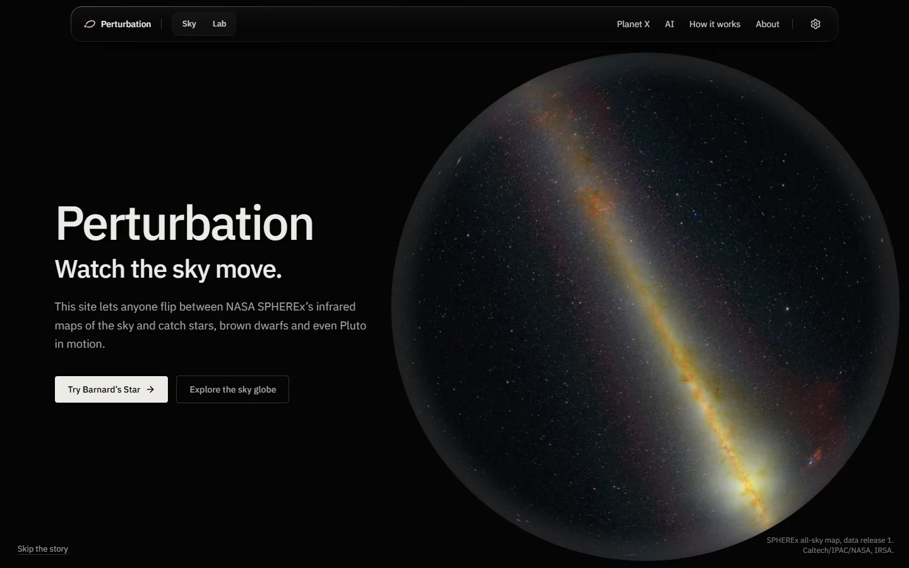
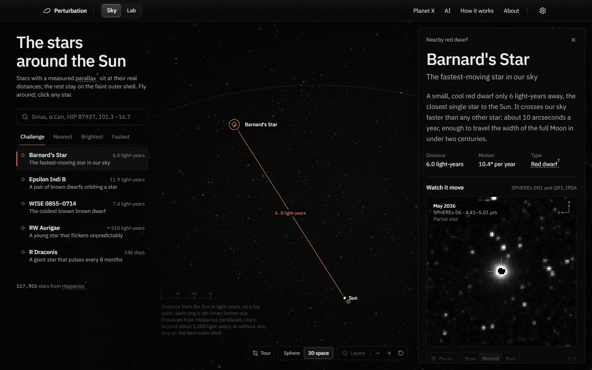
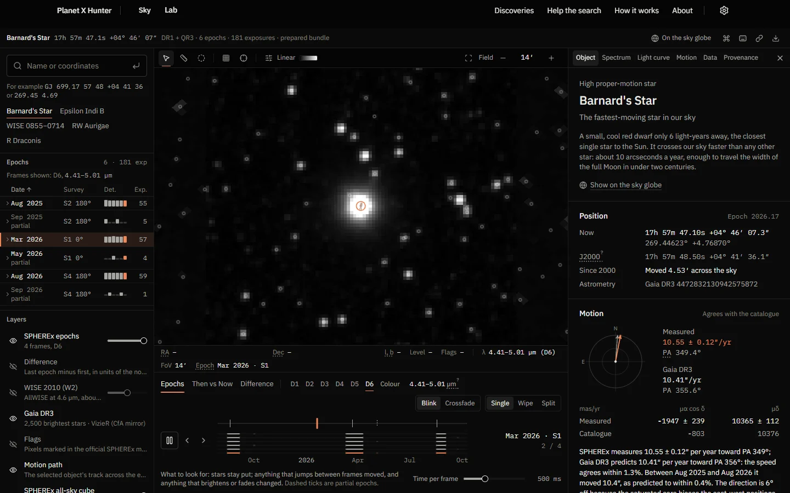
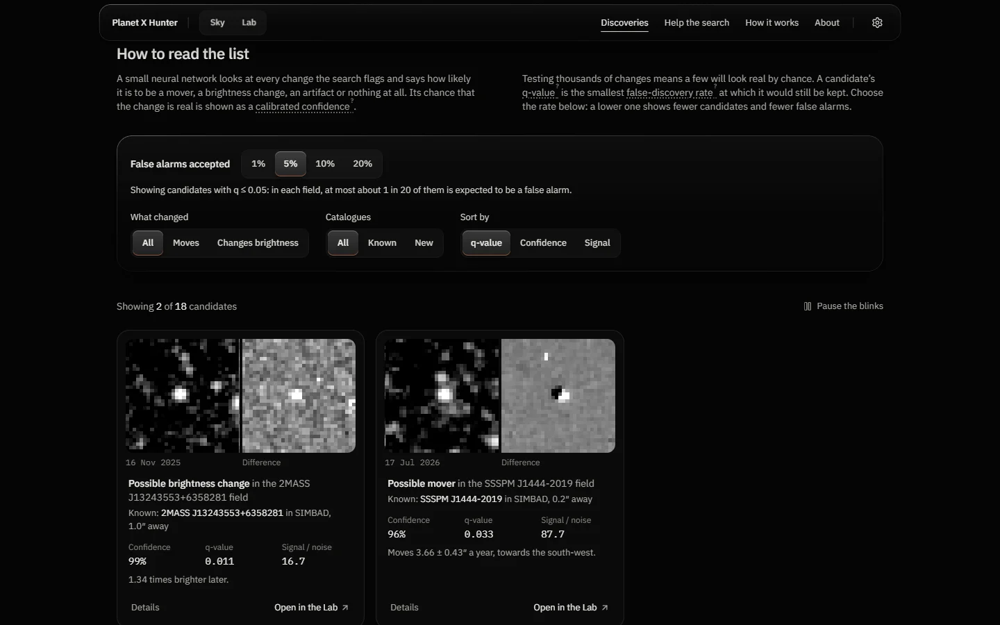

# Planet X Hunter

Planet X Hunter is a public website for NASA's SPHEREx infrared sky survey: pick any patch of sky, blink between SPHEREx's visits, subtract them, measure how stars move and change brightness, read their 102-channel spectra, and browse the results of an automatic search of 53 fields for things that moved or changed. SPHEREx maps the whole sky about every six months, so any field can be compared with itself months apart, the way Clyde Tombaugh found Pluto in 1930 while hunting for "Planet X": by blinking two photographs of the same stars.

Made by team Ninth Vanguard for the NASA Space Apps Challenge 2026, challenge "Planet X and SPHEREx".

- **Live site:** [planet-x-hunter.vercel.app](https://planet-x-hunter.vercel.app)
- **Sky globe:** [/sky](https://planet-x-hunter.vercel.app/sky)
- **Lab, opened on Barnard's Star:** [/explore?target=barnards-star](https://planet-x-hunter.vercel.app/explore?target=barnards-star)
- **Discoveries:** [/discoveries](https://planet-x-hunter.vercel.app/discoveries)
- **How it works:** [/how-it-works](https://planet-x-hunter.vercel.app/how-it-works)
- **API:** base URL `https://planet-x-hunter-api.vercel.app/api` (try [/api/health](https://planet-x-hunter-api.vercel.app/api/health)), interactive docs at [/docs](https://planet-x-hunter-api.vercel.app/docs)

<p>
  
  
</p>
<p>
  
  
</p>

Top: the home page, and the Sky globe in 3D space focused on Barnard's Star. Bottom: the Lab on Barnard's Star, with its six visits and its motion measured against Gaia DR3, and the Discoveries list. Screenshots of the live site, 15 November 2026.

## What you can do

| Page | What it does |
|---|---|
| [Sky](https://planet-x-hunter.vercel.app/sky) | A globe of 117,955 Hipparcos stars in their true colours. Click a star for what is known about it and what SPHEREx has seen there, or switch to 3D space to see the stars at their real distances around the Sun. |
| [Lab](https://planet-x-hunter.vercel.app/explore?target=barnards-star) | A workbench for any patch of sky: blink SPHEREx's visits detector by detector, see difference images, compare with WISE images from 2010, and click a source for its motion, light curve and spectrum. The five challenge targets open from prepared data; any other position is built live from IRSA. |
| [Discoveries](https://planet-x-hunter.vercel.app/discoveries) | The automatic search's list: 18 candidates from 53 SPHEREx fields, each with its blink, difference stamp, calibrated confidence, q-value and catalogue match. You choose the false-alarm rate you accept (1%, 5%, 10% or 20%). |
| [Help the search](https://planet-x-hunter.vercel.app/help) | Look at blinking candidates from the search, with known objects mixed in as checks, and say what you see. Answers stay in your browser; you can download them as CSV or JSON. |
| [How it works](https://planet-x-hunter.vercel.app/how-it-works) | The method in eight steps, from SPHEREx exposures to measured motions, spectra and the automatic search, with the measured results, the limits, and a folded layer of detail for scientists. |
| [Settings](https://planet-x-hunter.vercel.app/settings) | Glass, motion and explanation marks; how the Sky globe and the Lab start; what this browser keeps. |
| [About](https://planet-x-hunter.vercel.app/about) | The challenge, the team, data credits and licences, and how to cite. |

## How it works

1. **Find and read the data.** The API discovers SPHEREx's collections at IRSA at run time (Data Release 1 and Quick Release 3 images, their deep fields, and the DR1 spectral cube), searches them by position and groups the exposures into visits. HTTP byte-range requests read only the pixels needed from each image file. (`pxh.spherex`)
2. **Stack each visit.** Every stamp is reprojected onto one north-up grid per field (6.15″ pixels), with the zodiacal light subtracted and flagged or overflowed pixels masked. The exposures of each visit and detector are averaged with inverse-variance weights. (`pxh.imaging.align`, `pxh.imaging.coadd`)
3. **Subtract.** The difference between two visits is divided by its own noise, so each pixel reads as a signal-to-noise ratio. A star that moved leaves a dark and a bright spot side by side (a dipole); one that changed brightness leaves a single spot. (`pxh.imaging.diff`)
4. **Detect and classify.** The finder looks for peaks of at least 5σ in the difference between the latest and earliest full visits, and between each pair of adjacent full visits. A positive and a negative peak together make a mover candidate; any other peak is a variable candidate. A small convolutional network, `realbogus_v1` (43,812 parameters, trained on synthetic movers and variables injected into real images of 31 training fields, plus the finder's real candidates in those fields), scores a 21 × 21 pixel stamp of each as mover, variable, artifact or nothing. (`pxh.ml.movers`, `pxh.ml.realbogus`)
5. **Control false alarms.** Each score becomes a conformal p-value against 3,400 null scores: 425 real candidates from 8 validation fields, each stamp in its 8 orientations. Benjamini-Hochberg q-values are computed over the candidates of one field, the same way in the Lab and in the survey. A candidate is reported at q ≤ 0.05; the Discoveries list also shows those up to q ≤ 0.2. (`pxh.ml.fdr`, `pxh.ml.finder`)
6. **Measure and cross-match.** Listed candidates get a motion fit or a brightness change, and are matched within 6″ to SIMBAD, Gaia DR3 and CatWISE2020, with catalogue positions moved by their proper motions. The live API matches against Gaia DR3. (`pxh.ml.movers`, `pxh.ml.finder`)
7. **Read spectra.** At any position the API measures a quick-look spectrum in the DR1 spectral cube (102 channels, 0.75 to 5.0 µm, 12.9″ pixels). A second network, `specclass_v1`, names the most likely of seven classes (hot star, Sun-like star, cool star, brown dwarf, young or dusty star, galaxy, quasar) and flags unusual spectra with a conformal p-value. It declines saturated or faint spectra. (`pxh.spherex.cube`, `pxh.ml.specclass`)

Both networks are trained with PyTorch in `ml/` and run in the API with plain NumPy.

## Measured results

Every number below comes from the validation reports [docs/validation/movers.md](docs/validation/movers.md) and [docs/validation/spectra.md](docs/validation/spectra.md), the first measurements of the five targets in [docs/data-findings.md](docs/data-findings.md) (Barnard's Star), the survey list [frontend/public/discoveries/candidates.json](frontend/public/discoveries/candidates.json) and the model files in [backend/src/pxh/ml/weights/](backend/src/pxh/ml/weights/). Synthetic sources were injected into real SPHEREx images of test fields that the models never saw.

| What was measured | Result |
|---|---|
| Barnard's Star proper motion, from star-image fits to 75 single exposures at 3.8 to 5.0 µm (detectors D5 and D6) that keep the saturated core's pixels with a valid early-ramp slope | 10.55 ± 0.12″ a year at 349.4° (Gaia DR3, moved to 2026: 10.41″ at 355.6°). The direction is 6.2° off because of one biased visit; averaging each visit's positions first gives 10.39 ± 0.28″ a year at 354.5° |
| Epsilon Indi B, found by the automatic finder (targeted test) | A mover at q = 0.010, moving 4.30 ± 0.39″ a year at 125° (catalogue: 4.68″ at 122°) |
| Synthetic movers reported, by the S/N their dipole can reach | 1 of 688 below 5; 5% at 5 to 10; 37% at 10 to 15; 68% at 15 to 20; 82% at 20 to 50; 97% at 50 to 100 |
| Synthetic movers reported at S/N ≥ 10, by their shift between the earliest and latest full visits | 1% under 0.25 pixel; 17% at 0.25 to 0.5 pixel; 45% at 0.5 to 1 pixel; 70% at 1 to 2 pixels; 73% at 2 to 4 pixels |
| All synthetic movers at S/N ≥ 10, 0.3 to 20″ a year | 27% (188 of 698) |
| Synthetic brightness changes at S/N ≥ 10 | 55% (385 of 698), rising to 67% at S/N 50 to 100 |
| False alarms in the 9 held-out test fields, nothing injected | 0 in 0.247 square degrees (outside 45″ of the known object at each field's centre): at most 12.2 per square degree (95% upper limit) |
| Steady synthetic stars reported as changed | 3 of 540 (0.6%), all brighter than S/N 30 |
| Mover and variable classifier, 5,867 test stamps | 83.7% right; validation calibration error 0.013 after temperature scaling |
| Survey of 53 fields, 1.47 square degrees, 3,919 candidates | 2 reported at q ≤ 0.05, both known ultracool dwarfs: a mover (next row) and a brightening that forced photometry does not confirm (1.4σ); 16 more listed at 0.05 < q ≤ 0.2; no new mover claimed |
| SSSPM J1444-2019, the survey's reported mover | 3.66 ± 0.43″ a year (catalogue: 3.51″) |
| Spectral classifier, 5,647 spectra from 43 held-out sky tiles | 76.1% accuracy (90% bootstrap range over tiles: 68.8% to 83.5%); macro F1 0.638 (0.551 to 0.702); calibration error 0.025 |
| Unusual-spectrum flag at p < 0.01 | Fires on 0.28% of ordinary test spectra and on 1.7% of 527 spectra of kinds never trained on; none of 33,685 untrained spectra passes q ≤ 0.1 |

What did not work, and why:

- **Saturated stars.** Barnard's Star, R Draconis and RW Aurigae are saturated in nearly every image (357 of 358, 842 of 842 and 306 of 335). The stacks mask their cores, so the automatic finder does not detect them; RW Aurigae just misses, at q = 0.051. Single exposures measure them instead ([docs/data-findings.md](docs/data-findings.md) §6): keeping the saturated core's pixels that still hold a valid early-ramp slope gives Barnard's Star's motion and RW Aurigae's fading, and a ring 8 to 12 pixels from R Draconis's centre gives its pulsation.
- **Slow movers.** SPHEREx pixels are 6.15″ wide and the visits span half a year to a little over a year, so a star moving 1″ a year shifts by a sixth of a pixel or less. At S/N ≥ 10, none of 187 synthetic movers at 0.3 to 1″ a year and 4 of 135 at 1 to 2″ a year were reported.
- **Brown dwarfs in the spectral classifier.** It gets both brown-dwarf targets wrong: Epsilon Indi B is called a young or dusty star (40%, flagged unusual), and WISE 0855−0714 a Sun-like star (60%): a neighbouring star dominates its quick-look spectrum, and training had no Y dwarfs. The brown-dwarf class had only 64 training spectra. The three saturated targets get no class.
- **Hot stars.** Only 29% of the spectra it calls hot stars are hot stars, and its biggest mix-up is calling 30% of the young or dusty stars hot stars.
- **A small null set.** The p-values compare against 3,400 scores from 8 validation fields, so in a field of about 60 candidates the first one reported must outscore all but one or two of them. More validation fields would loosen this.
- **The two survey detections are in training fields**, and the classifier saw their real candidates during training, so they show that the pipeline works end to end, not how well it generalises. The held-out test fields above measure that.
- **An unconfirmed brightening.** The survey's reported variable, the ultracool dwarf 2MASS J13243553+6358281, is a peak of S/N 17 in the difference image, but forced photometry at that spot measures −0.32 mag at only 1.4σ, so the change is not confirmed.

## Repository layout

| Path | What is there |
|---|---|
| [`frontend/`](frontend) | The website: Next.js 16, React 19, three.js and React Three Fiber for the globe, Aladin Lite 3.8.2 for the Lab's sky viewer. Playwright tests in `frontend/e2e/`; third-party credits in [`frontend/CREDITS.md`](frontend/CREDITS.md). |
| `frontend/public/` | Prepared data for the five challenge targets (`bundles/`), the survey's candidate list (`discoveries/`), model summaries (`models/`), star catalogues (`data/`) and sky textures. |
| [`backend/`](backend) | The API: the Python 3.13 package `pxh` with FastAPI. SPHEREx discovery and byte-range reads, alignment and stacking, differences, photometry, spectra, and the finder and both classifiers in NumPy. Vercel serves `backend/index.py`. |
| [`ml/`](ml) | Training and evaluation with PyTorch, a separate uv project. Trained weights go to `backend/src/pxh/ml/weights/`. |
| [`scripts/`](scripts) | Batch jobs: choosing and building the survey fields, the discovery run, the target bundles, the star catalogues and sky textures. |
| [`docs/`](docs) | The [API contract](docs/api-contract.md), the first measurements of the five targets ([data-findings.md](docs/data-findings.md) and `phase1/`), the [validation reports](docs/validation/) and these screenshots (`images/`). |

## Running it locally

**Website.** Needs Node.js 20.9 or later and pnpm.

```bash
pnpm install                                   # at the repository root (a pnpm workspace)
cp frontend/.env.example frontend/.env.local   # points the site at the public API
pnpm dev                                       # http://localhost:3000
```

Without `.env.local` the five challenge targets still work, but live fields, star lookups and quick-look spectra say the backend is not connected. Checks: `pnpm lint`, and `pnpm --dir frontend test:e2e` for the Playwright tests, which run in installed Google Chrome, start `pnpm dev` unless `E2E_BASE_URL` names another server, and load real images from IRSA.

**API.** Needs [uv](https://docs.astral.sh/uv/).

```bash
cd backend
uv sync                                  # Python 3.13 and the dependencies, into backend/.venv
uv run uvicorn index:app --port 8000     # http://localhost:8000/api/health, docs at /docs
uv run pytest                            # offline tests
uv run pytest -m network --network       # tests that call the live archives
```

To use a local API from the website, set `NEXT_PUBLIC_API_URL=http://localhost:8000` in `frontend/.env.local`.

**Models.** `cd ml && uv sync`, then follow [ml/README.md](ml/README.md): the survey data are built from `backend/` with `scripts/survey_fields.py` and `scripts/build_survey.py`, and each validation report ends with the commands that reproduce it.

## API

All endpoints answer `GET` under `https://planet-x-hunter-api.vercel.app/api`. Errors are JSON with `error`, `message` and `retryable`. Parameters and response shapes are in [docs/api-contract.md](docs/api-contract.md) and the [interactive docs](https://planet-x-hunter-api.vercel.app/docs).

| Method | Path | Purpose |
|---|---|---|
| GET | `/api/health` | Liveness and the SPHEREx collections found at IRSA |
| GET | `/api/targets` | The five challenge targets: position today, with proper motion applied, and their prepared data |
| GET | `/api/resolve` | A name or coordinates, resolved to a position today and at J2000 |
| GET | `/api/releases` | The SPHEREx collections discovered at run time |
| GET | `/api/field/summary` | Visits and coverage of a field, from the image search alone (no pixels) |
| GET | `/api/field/build` | One detector's stacked visits and difference image for a field, as PNG images in a manifest |
| GET | `/api/spectrum/quick` | The 102-channel quick-look spectrum at a position, from the DR1 spectral cube |
| GET | `/api/object` | Everything known at one spot: Gaia DR3, SIMBAD, SPHEREx coverage, quick-look spectrum |
| GET | `/api/patch` | What is in a patch of sky: its brightest stars, star count, SPHEREx coverage and spectrum |
| GET | `/api/catalog/gaia` | Gaia DR3 sources in a cone, moved to a given date |
| GET | `/api/catalog/wise` | AllWISE sources in a cone |
| GET | `/api/candidates` | Mover and variable candidates in one field, with classifier scores and q-values |

## Data sources, credits and licences

| Data | Credit | Terms |
|---|---|---|
| SPHEREx images and spectral cube | NASA/JPL-Caltech, served by the NASA/IPAC Infrared Science Archive (IRSA): Data Release 1 images doi:10.26131/IRSA678, the DR1 spectral cube doi:10.26131/IRSA679, and Quick Release 3 | NASA public data |
| AllWISE images (Then vs Now) | NASA/JPL-Caltech/UCLA, via IRSA | NASA public data |
| Gaia DR3 positions, motions and distances | ESA/Gaia/DPAC | Public; credit ESA/Gaia/DPAC |
| CatWISE2020 neighbours and survey matches | CatWISE team, via IRSA | NASA public data |
| SIMBAD object types | CDS, Strasbourg, via its CfA mirror | Public; credit CDS |
| Stars on the Sky globe | ESA Hipparcos: the Hipparcos Catalogue (ESA 1997) and its new reduction (van Leeuwen 2007), via VizieR, CDS | Public; credit ESA and CDS |
| Star names and constellation figures | d3-celestial by Olaf Frohn, collecting the IAU star names | BSD-3-Clause |
| Constellation boundaries | IAU boundaries (Roman 1987), via astropy | BSD-3-Clause (astropy) |
| WISE 0855−0714 motion | Kirkpatrick et al. 2021, ApJS 253, 7 | Published paper |
| Lab sky viewer | Aladin Lite, CDS, Strasbourg | LGPL-3.0 |

| Software and type | Licence |
|---|---|
| shadcn/ui and Radix UI | MIT |
| Cult UI text animation and Watermelon UI tabs | MIT |
| Skiper UI, free tier | Free with attribution |
| IBM Plex Sans and IBM Plex Mono | SIL Open Font License 1.1 |
| three.js, React Three Fiber, drei, Motion, Lenis, Recharts and the other libraries | MIT, ISC or Apache-2.0 |
| Planet X Hunter's own code | Apache-2.0 |

Interface components come from shadcn/ui, Cult UI, Watermelon UI and Skiper UI. The full list, with versions and sources, is in [frontend/CREDITS.md](frontend/CREDITS.md). The API and the training code are built on Astropy, reproject, photutils, NumPy, SciPy and FastAPI, and on PyTorch and scikit-learn for training ([backend/pyproject.toml](backend/pyproject.toml), [ml/pyproject.toml](ml/pyproject.toml)).

### How to cite

If you use what you find here, please credit the missions and catalogues behind it:

- **SPHEREx:** Data Release 1 images, doi:10.26131/IRSA678; the DR1 spectral cube, doi:10.26131/IRSA679; and Quick Release 3, all from the NASA/IPAC Infrared Science Archive. The [SPHEREx pages at IRSA](https://irsa.ipac.caltech.edu/Missions/spherex.html) give the mission's preferred acknowledgement.
- **Gaia DR3:** Gaia Collaboration, Vallenari et al. 2023, A&A 674, A1; see [ESA's Gaia credits](https://www.cosmos.esa.int/web/gaia-users/credits).
- **Hipparcos:** van Leeuwen 2007, A&A 474, 653.
- **WISE 0855−0714 motion:** Kirkpatrick et al. 2021, ApJS 253, 7.

To cite this tool:

> Team Ninth Vanguard (2026). Planet X Hunter: a public explorer of the changing infrared sky seen by SPHEREx. NASA Space Apps Challenge 2026. https://planet-x-hunter.vercel.app (source code: https://github.com/aaaravM/planet-x-hunter).

## Team and licence

Planet X Hunter is made by team Ninth Vanguard for the NASA Space Apps Challenge 2026. Questions, corrections and ideas are welcome as [GitHub issues](https://github.com/aaaravM/planet-x-hunter/issues).

The code is released under the [Apache License 2.0](LICENSE); `backend/pyproject.toml` and `ml/pyproject.toml` declare the same licence. The data and the third-party components above keep their own terms.
