# SPHEREx data findings: Phase 1 report

**Planet X Hunter** · NASA Space Apps Challenge 2026, "Planet X and SPHEREx" · Team Ninth Vanguard

Written Saturday 14 November 2026 (Pacific time), from the Phase 1 runs of that afternoon.

Before building any user interface, we checked five things: what the SPHEREx archive holds, how its files are built, which pixels can be trusted, how often a patch of sky is observed, and whether the five challenge targets show what the challenge expects. This report gives the answers. The data are what IRSA served on 14 November 2026: Data Release 1 plus Quick Release 3, with observations up to 2 October 2026 in our five fields.

**Where the numbers come from.** Every number was measured in Phase 1 on real SPHEREx pixels by code in this repository, unless it is marked *(from planning research)*. The sources are:

- the per-target outputs in [`docs/phase1/<target>/summary.json`](phase1/) and the figures next to them, written by [`scripts/phase1_probe.py`](../scripts/phase1_probe.py);
- the backend modules in [`backend/src/pxh`](../backend/src/pxh) and their tests.

*(From planning research)* marks facts that were checked live on the same morning but not measured again in Phase 1. A few cross-checks were computed for this report from the probe outputs, and they are labelled as such.

**How the targets were judged.** The pass/fail thresholds (fixed before the runs) were written into the probe before it ran. Where we added a measurement after seeing the data, it appears as a separate, labelled row. The rows fixed in advance remain the criteria of record.

**Contents**
1. [Summary](#1-summary)
2. [Data products and how we access them](#2-data-products-and-how-we-access-them)
3. [Inside a Level-2 file](#3-inside-a-level-2-file)
4. [Flags](#4-flags)
5. [Cadence](#5-cadence)
6. [Test-target results](#6-test-target-results)
7. [Where the brief met the data](#7-where-the-brief-met-the-data)
8. [Open issues and next steps](#8-open-issues-and-next-steps)

---

## 1. Summary

### What works

- **Finding the data.** The code discovers SPHEREx collections at run time instead of hard-coding them. It found the four Level-2 image collections (`spherex_dr1`, `spherex_dr1_deep`, `spherex_qr3`, `spherex_qr3_deep`) and the Year-1 spectral cube (`spherex_dr1_cube`).
- **Searching.** Position searches found 3,905 detector images over the five fields. We used 2,259 of them; the rest are deep-field exposures of R Draconis, thinned to one per detector pair per day.
- **Reading pixels.** We read only the bytes we need from IRSA's 65 MB files ("byte-range" requests). The pixels are bit-identical to IRSA's own cutouts in all four planes (image, variance, zodiacal light, flags), tested on four exposures from both releases. All 2,259 stamps were read without an error.
- **Wavelength of every pixel.** The per-pixel wavelength lookup reproduces an independent calculation for 358 exposures to better than 0.0002 of a channel width.
- **The full chain on all five targets.** Blink animations, difference images, positions and proper motions, spectra, light curves and the quick-look cube spectrum. The figures are in §6.
- **Tests.** 497 offline tests pass and 30 are skipped (re-run for this report). In the Phase 1 integration run, 29 tests against the live archives passed and 1 was skipped, because a CDS mirror answers HTTP 404.

### Headline measurements

- **Barnard's Star moves 10.55 ± 0.12″ per year** (Gaia: 10.41), measured from 75 single exposures at 3.8–5.0 µm, even though its core is saturated in 357 of 358 exposures. The blink shows it 10.36″ further north after one year.
- **Epsilon Indi B moves 4.699 ± 0.016″ per year toward position angle 121.5°** (Gaia: 4.685″ per year toward 121.8°), from 417 single-exposure positions. Its spectrum shows the water and methane absorption of a T dwarf, 80% and 76% deep, at 27σ and 66σ.
- **WISE 0855−0714, one of the coldest known brown dwarfs, is seen only at 3.8–5.0 µm.** Its 8.0″ shift over one year is detected at 10σ once a static neighbour star is modelled. In a single epoch it is detected at S/N 6–9 with noise measured from the image itself, below our target of 10.
- **RW Aurigae faded by 0.86 ± 0.04 magnitudes at 3.8–4.4 µm** between September 2025 and September 2026 (23σ).
- **R Draconis is saturated in every one of 842 measured exposures**, yet the outer wings of its image recover its 246-day pulsation. The fitted amplitude is 0.355 ± 0.018 mag, with the maximum at phase 0.03 of the catalogue's predicted maximum.
- **Cost.** 1.56 GB in 13,884 byte-range requests for 2,259 images, or 0.5–0.8 MB per image for a 6′ field. A repeated run, served from the cache, downloads 0.25 MB.

### The five targets at a glance

| Target | What it is | Epochs (full) | Time span | Images | Saturated | Result |
|---|---|---|---|---|---|---|
| Barnard's Star | Red dwarf with the largest proper motion of any star | 6 (3) | 403 days | 358 | 357 of 358 | **Pass 4/4** |
| Epsilon Indi B | Pair of brown dwarfs (T dwarfs), seen as one source | 4 (2) | 526 days | 461 | 2 of 459 | **Pass 5/5** |
| WISE 0855−0714 | Very cold, faint brown dwarf | 4 (2) | 374 days | 258 | 0 of 258 | **Partial 5/8** |
| RW Aurigae | Young variable star with a close companion | 3 (3) | 380 days | 335 | 306 of 335 | **Partial 1/2** |
| R Draconis | Pulsating red giant (Mira variable) near the north ecliptic pole | 17 bins of ≤ 30 days (11) | 520 days | 847 | 842 of 842 | **Pass 5/5** |

An *epoch* is a window of days in which SPHEREx scans a position. *Full* means every detector that saw the target did so at least 12 times. *Images* counts detector images, about two per exposure. *Saturated* counts measured exposures whose star core is flagged as saturated.

None of the failures traces to a code defect found so far. Each has a measured explanation (§6): a noise-model choice for WISE 0855, and an unresolved companion star for RW Aurigae.

### Phase 1 exit criteria

| Criterion | Status | Evidence |
|---|---|---|
| Collections are discovered programmatically | Met | §2.2 |
| Byte-range reads are pixel-exact | Met | Bit-identical to IRSA cutouts for 4 exposures (DR1 D6 and D3, QR3 D3 and D2), all four planes; the S3 mirror gives identical stamps (§2.4) |
| The Barnard's Star blink shows motion | Met | Difference-image dipole in D6 (S/N +222 at the star's new position); 10.36″ northward shift between August 2025 and August 2026 (§6.1) |
| Motion fit within 5% of Gaia (\|Δμ\| < 0.52″/yr) | Met for the speed; see note | Speed within 1.3% (0.14″/yr). The fitted direction is 6.2° off, so the vector difference is 1.14″/yr. It is driven by one biased epoch; fitting epoch means instead gives 0.20″/yr (§6.1) |
| ≥ 17 channels per detector in each full epoch | Mostly | 43 of 58 detector-epochs sampled all 17 channels, 9 sampled 16 and 2 sampled 15. WISE 0855's last DR1 epoch sampled 12–16 (§5.3) |
| Findings document written | Met | This report |

---

## 2. Data products and how we access them

### 2.1 Collections

IRSA, NASA's infrared science archive, serves SPHEREx in *collections*. Level 2 means single calibrated exposures; Level 3 means a product combined from many exposures.

| Collection | Contents | Size and time span *(from planning research)* | Used in Phase 1 for |
|---|---|---|---|
| `spherex_dr1` | Data Release 1 (Year 1, Surveys 1–2): Level-2 detector images from the wide survey | 945,725 images; 2025-04-24 → 2026-05-14 | All five targets |
| `spherex_dr1_deep` | DR1 deep fields at the ecliptic poles | 233,681 images | R Draconis |
| `spherex_qr3` | Quick Release 3 (Year 2, Surveys 3–4), published in weekly batches | 362,124 images; 2026-05-14 → 2026-10-05 | Four targets. WISE 0855 has no Year-2 data yet |
| `spherex_qr3_deep` | QR3 deep fields | 86,700 images | R Draconis |
| `spherex_dr1_cube` | Level-3 all-sky cube: 102 wavelength channels on HEALPix tiles (an equal-area sky grid) of 512 × 512 × 102 pixels, 12.9″ per pixel | Year 1 | Quick-look spectra of all five targets |
| `spherex_dr1_cal` | Calibration files (query service only) | — | Not used |

*(From planning research)* Quick Releases 1 and 2 can no longer be searched, and the old `spherex_qr` collection returns nothing, so collection names change between releases. The source catalogue is due in August 2027 and DR2 in December 2027.

### 2.2 Finding releases at run time

[`pxh.spherex.sia`](../backend/src/pxh/spherex/sia.py) asks IRSA's image search, SIA (Simple Image Access, a Virtual Observatory standard), for `FACILITY=SPHEREx` at the north ecliptic pole. Every SPHEREx collection covers that point. The answer lists every searchable collection, with one example row per collection that gives its calibration level and product type, all in one request of about 38 KB. The result is cached for 24 hours. The built-in fallback list in [`config.py`](../backend/src/pxh/config.py) is used only when IRSA cannot be reached and no cache exists.

In Phase 1 discovery returned exactly five collections: the four Level-2 image collections (calibration level 2) and `spherex_dr1_cube` (level 3).

What the search rows show about releases:

- **Processing tags.** Every file name carries one, such as `l2b-v27-2026-228`. Across our five fields the tags run from `-196` to `-285`. 19 of the 3,905 files are `l2b_retry` reprocessings. Our caches use the file name as the key, so a reprocessed file is fetched again.
- **Release delay.** QR3 files in our fields were published 27–147 days after the observation, about 40 days in the median. Planning research found 24–45 days.
- **Latest data.** The most recent Year-2 exposure in our fields is from 2 October 2026 (Epsilon Indi B).

For the app this means new data arrives about weekly. A weekly check of the collection list, and of the latest observation time per field, is enough.

### 2.3 Searching for images

`GET https://irsa.ipac.caltech.edu/SIA?COLLECTION=<c>&POS=CIRCLE <ra> <dec> <r>&MAXREC=<n>`. Each row describes one detector image and follows the ObsCore standard (51 columns, *from planning research*). We map it to a `DetectorImage` in [`models.py`](../backend/src/pxh/models.py). The columns we use are `obs_id`, `energy_bandpassname` (detector), `em_min`/`em_max` (wavelength range), `t_min`/`t_max` (MJD), `t_exptime`, `s_region` (footprint), `access_url` (the file on IRSA's server), `obs_release_date`, `obs_publisher_did` and `cloud_access` (the key of the same file on the public Amazon S3 mirror).

The two images of one exposure (a detector pair, §5.1) share `obs_id` and `t_min`. Every exposure lasts 113.58 s.

| Field | `spherex_dr1` | `spherex_dr1_deep` | `spherex_qr3` | `spherex_qr3_deep` | Images found | Images used |
|---|---|---|---|---|---|---|
| Barnard's Star | 239 | — | 119 | — | 358 | 358 |
| Epsilon Indi B | 341 | — | 120 | — | 461 | 461 |
| WISE 0855−0714 | 258 | — | 0 | — | 258 | 258 |
| RW Aurigae | 226 | — | 109 | — | 335 | 335 |
| R Draconis | 413 | 1,225 | 126 | 729 | 2,493 | 847 |

Deep collections were searched only for R Draconis, which lies in the north ecliptic pole deep field. Its deep exposures were capped at one per detector pair per UTC day (161 of 985 kept) to stay within the download budget.

### 2.4 Reading pixels: byte ranges instead of cutouts

A Level-2 file is about 65 MB; the exact size varies with how well the flags compress. A *byte-range request* asks the server for a few slices of the file instead of all of it. [`pxh.spherex.l2`](../backend/src/pxh/spherex/l2.py) reads one detector image in two steps:

1. **Layout, about 180 KB, two requests, cached on disk.** All the extension headers plus the wavelength table (§3). Where the later extensions start depends on the compressed size of the flags, so the code walks the headers and never assumes fixed offsets.
2. **Stamp, a few more requests.** For each row of the box: the needed pieces of the image, variance and zodiacal-light rows, and the compressed flags row. A 6′ stamp took 5–6 requests per image in Phase 1, layout included.

Checks:

- Stamps equal IRSA cutouts bit for bit for four Barnard's Star exposures (DR1 D6, DR1 D3, QR3 D3, QR3 D2) in all four planes ([`tests/test_l2.py`](../backend/tests/test_l2.py), network tests).
- The same stamp read from the S3 mirror equals the one from IRSA's file server.

| Way to get pixels | Cost per image | Notes |
|---|---|---|
| IRSA cutout service | ≥ 3.95 MB and 1.3–2.7 s, whatever the box size *(from planning research)* | Every cutout carries the 3.86 MB point-spread-function table. Used only as a test oracle |
| Byte ranges, 2′ box | about 4 KB of pixels *(from planning research)* | — |
| Byte ranges, 6′ box (Phase 1) | 0.52–0.79 MB the first time, including the 180 KB layout | Dominated by the compressed flags: about 5.4 KB per detector row, and the whole row must be read. Detectors rotated against north need 85–87 rows to cover a 59-pixel north-up grid |
| Point-spread-function table | 3.9 MB per detector, once | All 2,259 images in Phase 1 use the same six calibration files, one per detector, in both releases |

Server rules, all built into [`pxh.spherex.rangeio`](../backend/src/pxh/spherex/rangeio.py):

- IRSA's file server (IBE) accepts up to 100 ranges per request, with a Range header under about 8 KB.
- If it answers 200 instead of 206, it is streaming the whole 65 MB file, and we abort.
- The S3 mirror (`https://nasa-irsa-spherex.s3.us-east-1.amazonaws.com/<key>`) accepts single ranges only, so ranges are merged before asking it.

### 2.5 Performance

First run of each target, with 6 worker threads and at most 4 simultaneous requests to IRSA:

| Target | Images | Downloaded | Requests | Per image | Stamp reading | Re-run from cache |
|---|---|---|---|---|---|---|
| Barnard's Star | 358 | 209.1 MB | 1,816 | 0.52 MB, after subtracting 23 MB of one-off ePSF tables | 69 s | 65 s |
| Epsilon Indi B | 461 | 363.6 MB | 2,774 | 0.79 MB | 119 s | 80 s |
| WISE 0855−0714 | 258 | 188.4 MB | 1,566 | 0.73 MB | 56 s | 74 s |
| RW Aurigae | 335 | 196.7 MB | 1,800 | 0.59 MB | 72 s | 35 s |
| R Draconis | 847 | 600.9 MB | 5,752, of which 780 retries | 0.71 MB | 448 s | 149 s |
| **All runs** | 2,259 | **1,561 MB** | **13,884** | | | |

- A first run took 96–498 s end to end, and a cached re-run 35–149 s.
- A re-run still downloads about 0.25 MB (16 requests), because the cube quick-look pixels are not cached yet.
- The cube quick-look spectrum itself takes 1.2–3.0 s per position.
- The total includes 11 cached re-runs. It is about 4% over the 1.5 GB budget we set for Phase 1.

### 2.6 Reliability

| Service | Phase 1 | Planning research |
|---|---|---|
| IRSA image search (SIA) | 2 requests per target on first runs, no errors | HTTP 502 on about half of all attempts, always recovered within 8 tries. The `TIME` parameter always fails, so we never send it |
| IRSA file server (IBE) | Bursts of HTTP 503 during the R Draconis run: 780 retries, all recovered | No failures |
| IRSA catalogue queries (TAP) | Not used | Synchronous queries unusable |
| CDS Strasbourg (SIMBAD, VizieR, Sesame, Aladin sky maps) | All five targets resolved from our local name table; the CDS SIMBAD query mirror returns HTTP 404 | Degraded since about 9 November; the CfA and IDIA mirrors work |

The request policy for all IRSA calls:

- up to 8 attempts, with exponential back-off from 2 to 16 s plus random jitter;
- at most 4 requests in flight;
- on the image search, a circuit breaker that stops calling for 60 s after 12 consecutive failures;
- caches on disk for searches, layouts, stamps and ePSFs.

The browser never calls IRSA directly.

---

## 3. Inside a Level-2 file

Each file holds one detector's image from one exposure (2040 × 2040 pixels of 6.15″). Its seven parts (HDUs, header-data units), in file order:

| # | HDU | Contents | Format, and how we read it |
|---|---|---|---|
| 0 | PRIMARY | Header only | — |
| 1 | IMAGE | Surface brightness, MJy/sr | float32, big-endian, 2040 × 2040. PRIMARY plus this header end at byte 25,920 or 28,800; each row is 8,160 bytes. Read as row segments |
| 2 | FLAGS | 32-bit quality bitmask per pixel (§4) | RICE_1-compressed table with one tile per detector row (`ZTILE1 = 2040`, `ZTILE2 = 1`). Each row has an 8-byte descriptor (length, offset) into a compressed heap, which is 11.06 MB in our example file. Decoded with astropy's codec or our pure-Python port |
| 3 | VARIANCE | Pixel variance, (MJy/sr)² | float32. Its offset depends on the compressed size of FLAGS |
| 4 | ZODI | Model of the zodiacal light (sunlight scattered by interplanetary dust), MJy/sr | float32. Subtracted before co-adding |
| 5 | EPSF | 441 effective PSFs (451 for D3), one per zone of a grid over the detector | Table: `XCENTER`, `YCENTER`, `CWAVE`, `NSTAR`, … and `EPSF`, 33 × 33, oversampled 5×, each summing to 1 |
| 6 | WCS-WAVE | Wavelength and bandwidth on a coarse grid of control points | Small table, read together with the layout |

**Units and fluxes.** Flux per pixel in µJy = I [MJy/sr] × 10¹² × Ω, where Ω is the pixel solid angle in steradians: `OMEGA_MEDIAN` [arcsec²] × (π/648000)². In our example `OMEGA_MEDIAN` is 37.94 arcsec². Magnitudes in this report are AB magnitudes, −2.5 log₁₀(F / 3631 Jy).

**Header keys we rely on** (example: exposure `2025W33_2C_0321_1`, detector D6, Barnard's Star):

| Key | Meaning | Example |
|---|---|---|
| `MJD-BEG`, `MJD-AVG`, `MJD-END` | Start, middle and end of the exposure (UTC). We move every target position to `MJD-AVG` | 60902.8647, 60902.8654, 60902.8660 |
| `XPOSURE` | Exposure time | 113.5826 s |
| `PSF_FWHM` | Median width of a star image | 9.04″, about 1.5 pixels |
| `OMEGA_MEDIAN` | Median pixel solid angle | 37.936 arcsec² |
| `SPS_EPA` | Orientation: position angle of the focal-plane y axis, east of ecliptic north | 180 (always 0 or 180) |
| `X_SC`, `Y_SC`, `Z_SC`, `VX_SC`, … | Spacecraft position (km) and velocity (km/s) relative to Earth's centre | −3735, −5521, 2222 km |
| `CTYPE1/2`, `A_*`, `B_*` | Sky coordinates: a TAN projection with SIP distortion polynomials of order 3 | `RA---TAN-SIP` |
| `MSKN*`, `MSKM*`, `MSKD*` | Flag names, bit masks and descriptions. In DR1 these sit in the FLAGS header, not the IMAGE header | §4 |

**Target positions.** A star's catalogue position is moved to each exposure's `MJD-AVG` with its proper motion and parallax, including perspective acceleration ([`pxh.sky.propagate`](../backend/src/pxh/sky/propagate.py)). SPHEREx's distance from Earth's centre in low orbit moves Barnard's Star by less than 0.03 mas, so it is ignored.

**The wavelength of each pixel.** Each detector sits behind a filter whose passband changes across the detector (a linear variable filter), so every pixel has its own wavelength. Six detectors with 17 channels each make the 102 channels.

| Detector | D1 | D2 | D3 | D4 | D5 | D6 |
|---|---|---|---|---|---|---|
| Wavelength range in SIA rows (µm) | 0.746–1.117 | 1.103–1.650 | 1.630–2.435 | 2.403–3.847 | 3.811–4.430 | 4.412–5.010 |
| Resolving power λ/Δλ ([`config.py`](../backend/src/pxh/config.py)) | 39 | 41 | 41 | 35 | 112 | 128 |

How the lookup works, in [`pxh.spherex.wavelength`](../backend/src/pxh/spherex/wavelength.py):

- The IMAGE header defines a second coordinate system, `W` (`WAVE-TAB`), that points to the WCS-WAVE table.
- That table holds control points in raw detector pixels (`X`, `Y`) and a `VALUES` array of [central wavelength, bandwidth].
- We interpolate bilinearly between the control points.
- The grids differ per detector, from 9 × 9 up to 13 × 20 points, with one-pixel steps at the dichroic edges of D3 and D4.
- In full files `CRPIXjW = CRVALjW = 1`; IRSA cutouts shift `CRPIXjW`, and the code handles both.

Checks and a pitfall:

- The lookup reproduces an independent research implementation at Barnard's Star in 358 exposures, all six detectors, both releases, to under 0.0002 of a bandwidth.
- It matches astropy's own evaluation to 10⁻¹³, but only after the celestial SIP keywords are removed. Otherwise astropy applies the sky-distortion polynomials to the wavelength axes too, which corrupts the wavelengths by up to 0.4 bandwidth near the far corner of D6.

*(From planning research)* Wavelength runs along detector rows at about 115–120 pixels per channel.

**Point-spread functions.** The EPSF extension gives the shape of a point source in each detector zone. [`pxh.photometry`](../backend/src/pxh/photometry) fits the zone nearest the star (photutils `ImagePSF(data=epsf × 25, oversampling=5)`).

At 9″ across, a star image is only about 1.5 pixels wide, so it is undersampled. Resampling one exposure onto a new grid changes its peak and its sum by a few per cent. We therefore blink resampled images but measure fluxes and positions on the original pixels.

**The DR1 cube (Level 3)**, read by [`pxh.spherex.cube`](../backend/src/pxh/spherex/cube.py):

- **Tiles.** Each tile is a FITS file with IMAGE (512 × 512 × 102, MJy/sr), NHITS (number of exposures per pixel), FLAGS, SPECTRAL_CHANNELS and WCS-WAVE. An example is `…/spherex/dr1/hips5_cube/hips_20261026/Norder5/Dir0/Npix7945_cube.fits`.
- **Pixels.** A cube pixel is a HEALPix cell of order 14: 165.97 arcsec², 12.88″ on a side.
- **Blank channels.** Planes 50 and 51 are blank. They are D3 channel 17 and D4 channel 1, the two channels at the dichroic.
- **Purpose.** IRSA labels the cube "for visualization": it has no aperture correction, and pixels on bright stars are often blank.
- **Cost.** One quick-look spectrum costs 16 requests and about 248 KB.

How the cube quick-look compares with our Level-2 photometry. This cross-check was computed for this report: the median ratio of cube flux to Level-2 flux at matching wavelengths, Year-1 epochs only.

| Target | Channels the cube marks complete | Cube ÷ Level-2 | Why |
|---|---|---|---|
| Epsilon Indi B (unsaturated, isolated) | 100 of 100 | 0.95–1.05 in every detector | Agrees |
| RW Aurigae (saturated) | 85, plus 15 lower limits | 0.20 at 1.65–2.45 µm; 0.48 at 2.45–3.85 µm (2 channels); 0.74–1.01 elsewhere | Saturated star: the cube reads low even in channels it marks complete (cause not investigated) |
| Barnard's Star (saturated) | 9, plus 91 lower limits | 0.26 where complete (4.3–5.0 µm) | Saturated core |
| R Draconis (saturated) | 0, plus 82 lower limits | — | Saturated core |
| WISE 0855−0714 (faint, with a neighbour) | 100 of 100 | 2.2–8.7 below 3.85 µm; 0.82–1.16 above | The 12.9″ cube pixels include the neighbour star |

---

## 4. Flags

Every pixel carries a 32-bit integer, and each bit is a yes/no warning set by the pipeline. The bit names come from each file's own `MSKN` keywords ([`pxh.spherex.flags`](../backend/src/pxh/spherex/flags.py)), so we never hard-code bit numbers. The table below is the complete set from a DR1 file (`level2_2025W33_2C_0321_1D6`). The DR1 cube uses the same bits, without FULLSAMPLE.

| Bit | Name | Pipeline description | Our group | How we use it |
|---:|---|---|---|---|
| 0 | TRANSIENT | Transient detected during SUR (the onboard fit up the exposure's ramp of reads) | invalid | Masked in co-adds. Near a saturated core it marks pixels whose onboard fit stopped early at a detected jump, often the onset of bloom spill-over; star fits can still use them (§6.6) |
| 1 | OVERFLOW | Overflow detected during SUR | saturation | Marks saturation. Masked in co-adds and shown as the saturation overlay. A measurement is labelled *saturated* when its 3 × 3 core has it |
| 2 | SUR_ERROR | Error in onboard processing | invalid | Masked. Together with OVERFLOW it marks "early overflow", which is never used |
| 6 | NONFUNC | Permanently unusable | invalid | Masked |
| 7 | DICHROIC | Low efficiency due to dichroic | — | Not masked |
| 9 | MISSING_DATA | Onboard data lost | invalid | Masked |
| 10 | HOT | Hot pixel | invalid | Masked |
| 11 | COLD | Anomalously low signal | invalid | Masked |
| 12 | FULLSAMPLE | Pixel full sample history is available | info | Ignored |
| 14 | PHANMISS | Phantom correction was not applied | invalid | Masked |
| 15 | NONLINEAR | Nonlinearity correction cannot be applied reliably | invalid | Masked |
| 17 | PERSIST | Persistent charge above threshold | artifact | Masked |
| 19 | OUTLIER | Pixel flagged by Detect Outliers | artifact | Masked |
| 20 | CROSSTALK | Pixel affected by crosstalk | artifact | Masked |
| 21 | SOURCE | Pixel mapped to a known source | info | Never masked: it covers 76–95% of pixels in crowded fields *(from planning research)*. An optional overlay |
| 22 | GHOST | Affected by a bright source inside the exposure | artifact | Masked |
| 23 | GHOST_FPA | Affected by a bright source on another detector | artifact | Masked |
| 24 | GHOST_EXT | Pixel affected by a bright source outside the field of view | artifact | Masked |
| 25 | STREAK | Pixel affected by a streak | artifact | Masked |
| 26 | BLOOM | Pixel part of a bloom artifact (charge spilling from a saturated pixel) | artifact | Masked in co-adds. Usable in a saturated core, like TRANSIENT |
| 27 | SNOWBALL | Pixel part of a snowball artifact | artifact | Masked. Missing from some DR1 headers, see below |
| 28 | HALO | Pixel part of a transient halo | artifact | Masked |
| 29 | SATELLITE_HALO | Pixel part of a satellite streak halo | artifact | Masked. Absent from DR1 Level-2 headers (IRSA documents it, and the cube header has it), so the code adds it as a fallback |

Bits 3–5, 8, 13, 16, 18, 30 and 31 are not defined.

The default science mask combines the *invalid* and *artifact* groups (bit mask 0x3FDACE45). Saturation (OVERFLOW) is handled separately. The UI will overlay the flags in three groups: invalid, artifact and informational.

What Phase 1 found about flags:

- **SNOWBALL is missing from 29 DR1 files** (processing tags `v27-2026-230` to `-232`). Four of the five fields mix files with and without it. Bit numbers never conflict, so co-adds combine the per-file masks with OR, and every defined artifact bit stays masked.
- **What a saturated core looks like.** At Barnard's Star the photometry aperture typically carries TRANSIENT + OVERFLOW + SUR_ERROR + SOURCE + BLOOM, sometimes with PERSIST, or NONFUNC + HALO. The cube's core pixels carry TRANSIENT + SUR_ERROR + BLOOM.
- **The bloom footprint of a very bright star is large.** Around R Draconis, BLOOM, TRANSIENT or SUR_ERROR cover a ring 3–6 pixels from the centre in 82–94% of exposures (§6.5).

---

## 5. Cadence

### 5.1 How SPHEREx observes a position

- **Two detectors at once.** Each 113.58 s exposure images the same spot on a short- and a long-wavelength detector simultaneously: D1 + D4, D2 + D5 or D3 + D6.
- **Wavelength changes between exposures.** Between exposures the telescope steps by one channel, 11.8′, so the target lands on a different wavelength each time; every frame contains 17 strips at different wavelengths *(both from planning research)*. Phase 1 confirms the result: within one epoch a target is measured in up to 17 different channels per detector.
- **Wide survey** (measured in Phase 1):
  - A position is seen in windows ("epochs") about six months apart.
  - Full epochs lasted 10–45 days and held 50–78 exposures.
  - Each detector saw the target 14–36 times per full epoch, which gives one complete spectrum per epoch.
  - Some windows are partial. They are either small clusters of 1–15 exposures near the main windows (Barnard's Star, WISE 0855), or long windows in which one detector pair saw the target only a few times (Epsilon Indi B). We keep them as partial epochs.
- **Repeats at one wavelength** come only 120–250 days apart *(from planning research)*.
- **Survey years.**
  - Year 1 (DR1, Surveys 1–2) ends and Year 2 (QR3, Surveys 3–4) begins on 14 May 2026.
  - Phase 1 measured the boundary: the last DR1 exposure ends at MJD 61174.5017 and the first QR3 exposure starts at MJD 61174.5327. The code now splits the years at MJD 61174.52. The old value, 61174.0, put DR1 exposures of 14 May into Year 2 and gave WISE 0855 a spurious one-exposure epoch.
  - *(From planning research)* Year 2 is offset from Year 1 by half a channel.
- **Orientation.** The image orientation flips by 180° between surveys (`SPS_EPA` 0 or 180) *(from planning research)*. At Barnard's Star the August 2025 and August 2026 epochs have `SPS_EPA` = 180 and the March 2026 epoch has 0. In Phase 1, field stars in its co-adds shift by 0.11–0.25″ east between epochs of opposite orientation (March vs August 2026), and by under 0.08″ between epochs of the same orientation (August 2025 vs August 2026).

### 5.2 Epochs of each target

The columns *Images per detector* and *Channels per detector* list D1/D2/D3/D4/D5/D6. A dash means that detector did not see the target. *Channels* is the number of distinct channels, of 17, in which the target was measured.

**Barnard's Star.** DR1 and QR3; 358 images, 181 exposures; 2025-08-15 → 2026-09-22.

| Epoch | Dates | Days | Year | Full | Exposures | Images per detector | Channels per detector |
|---|---|---|---|---|---|---|---|
| E0 | 2025-08-15 → 09-05 | 20.2 | 1 | yes | 55 | 19/18/18/18/18/17 | 16/17/17/17/17/16 |
| E1 | 2025-09-30 → 10-01 | 0.7 | 1 | no | 5 | 5/–/–/5/–/– | 4/–/–/5/–/– |
| E2 | 2026-03-11 → 04-10 | 29.9 | 1 | yes | 57 | 18/18/20/18/19/20 | 17 on all six |
| E3 | 2026-05-04 → 05-05 | 1.0 | 1 | no | 4 | –/–/4/–/–/4 | –/–/4/–/–/4 |
| E4 | 2026-08-16 → 09-02 | 16.6 | 2 | yes | 59 | 18/24/17/18/23/17 | 17 on all six |
| E5 | 2026-09-22 | 0.0 | 2 | no | 1 | –/1/–/–/1/– | –/1/–/–/1/– |

**Epsilon Indi B.** DR1 and QR3; 461 images, 239 exposures; 2025-04-24 → 2026-10-02.

| Epoch | Dates | Days | Year | Full | Exposures | Images per detector | Channels per detector |
|---|---|---|---|---|---|---|---|
| E0 | 2025-04-24 → 06-10 | 46.3 | 1 | no (D1/D4 only 4 each) | 62 | 4/32/26/4/30/24 | 3/16/14/3/16/14 |
| E1 | 2025-09-28 → 11-12 | 44.9 | 1 | yes | 78 | 24/30/23/23/24/22 | 17/15/17/17/17/17 |
| E2 | 2026-04-18 → 05-04 | 15.3 | 1 | no | 39 | 20/7/12/19/6/11 | 17/6/10/17/6/10 |
| E3 | 2026-09-22 → 10-02 | 10.3 | 2 | yes | 60 | –/24/36/–/24/36 | –/17/17/–/17/17 |

**WISE 0855−0714.** DR1 only, so far; 258 images, 129 exposures; 2025-05-05 → 2026-05-14.

| Epoch | Dates | Days | Year | Full | Exposures | Images per detector | Channels per detector |
|---|---|---|---|---|---|---|---|
| E0 | 2025-05-05 → 05-06 | 0.8 | 1 | no | 15 | 4/8/3/4/8/3 | 4/8/3/4/8/3 |
| E1 | 2025-10-31 → 11-14 | 14.2 | 1 | yes | 55 | 18/19/18/18/19/18 | 15/17/17/17/17/17 |
| E2 | 2025-12-11 → 12-13 | 1.6 | 1 | no | 9 | –/6/3/–/6/3 | –/6/3/–/6/3 |
| E3 | 2026-04-21 → 05-14 | 23.1 | 1 | yes | 50 | 14/15/21/14/15/21 | 13/12/16/13/12/16 |

**RW Aurigae.** DR1 and QR3; 335 images, 168 exposures; 2025-09-01 → 2026-09-16.

| Epoch | Dates | Days | Year | Full | Exposures | Images per detector | Channels per detector |
|---|---|---|---|---|---|---|---|
| E0 | 2025-09-01 → 09-20 | 18.8 | 1 | yes | 56 | 19/18/19/19/18/19 | 17/16/17/17/17/17 |
| E1 | 2026-02-20 → 03-12 | 19.3 | 1 | yes | 57 | 19 on all six | 16/16/17/16/17/17 |
| E2 | 2026-09-02 → 09-16 | 14.8 | 2 | yes | 55 | 18/18/18/18/19/18 | 17/16/17/17/17/17 |

**R Draconis.** Wide plus deep fields, cut into bins of at most 30 days.

- Images: 2,493 found; 847 used, from 273 wide-survey exposures and 161 of 985 deep exposures.
- Dates: 2025-04-24 → 2026-09-27.

| Bin | Dates | Days | Year | Exposures | Images by collection | Detectors seen (images/channels) |
|---|---|---|---|---|---|---|
| B0 | 2025-04-24 → 05-20 | 25.8 | 1 | 17 | dr1 12, dr1_deep 21 | D3 17/6, D6 16/6 |
| B1 | 2025-06-02 → 07-01 | 29.6 | 1 | 49 | dr1 96 | D1 4/4, D2 28/17, D3 17/16, D4 4/4, D5 27/17, D6 16/15 |
| B2 | 2025-07-02 → 07-22 | 19.8 | 1 | 23 | dr1 45 | D1 18/14, D2 5/5, D4 17/14, D5 5/5 |
| B3 | 2025-08-29 → 09-26 | 27.7 | 1 | 18 | dr1_deep 36 | D1 18/11, D4 18/10 |
| B4 | 2025-09-30 → 10-27 | 27.0 | 1 | 27 | dr1 38, dr1_deep 16 | D1 27/17, D4 27/17 |
| B5 | 2025-10-30 → 11-28 | 28.6 | 1 | 38 | dr1 65, dr1_deep 10 | D1 31/17, D2 7/7, D4 30/17, D5 7/7 |
| B6 | 2025-11-30 → 12-30 | 29.7 | 1 | 42 | dr1 83 | D2 30/17, D3 11/10, D5 31/17, D6 11/10 |
| B7 | 2025-12-30 → 2026-01-13 | 13.5 | 1 | 13 | dr1 26 | D3 13/11, D6 13/12 |
| B8 | 2026-02-08 → 03-10 | 29.5 | 1 | 20 | dr1_deep 37 | D3 20/11, D6 17/10 |
| B9 | 2026-03-11 → 04-10 | 29.2 | 1 | 29 | dr1_deep 54 | D3 26/9, D6 28/11 |
| B10 | 2026-04-11 → 05-11 | 29.8 | 1 | 32 | dr1 42, dr1_deep 21 | D3 31/17, D6 32/17 |
| B11 | 2026-05-13 | 0.0 | 1 | 3 | dr1 6 | D3 3/3, D6 3/3 |
| B12 | 2026-05-16 → 06-12 | 27.5 | 2 | 21 | qr3 41 | D3 20/11, D6 21/12 |
| B13 | 2026-06-21 → 07-21 | 29.9 | 2 | 47 | qr3 85, qr3_deep 8 | D1 28/17, D2 19/17, D4 27/17, D5 19/17 |
| B14 | 2026-07-25 → 08-23 | 29.1 | 2 | 30 | qr3_deep 56 | D1 26/8, D4 30/10 |
| B15 | 2026-08-24 → 09-21 | 27.8 | 2 | 22 | qr3_deep 44 | D1 22/10, D4 22/10 |
| B16 | 2026-09-24 → 09-27 | 2.4 | 2 | 3 | qr3_deep 5 | D1 3/2, D4 2/2 |

### 5.3 How complete is one epoch's spectrum?

In the 10 full wide-survey epochs of the four non-deep targets there are 58 detector-epochs:

| Channels sampled, of 17 | 17 | 16 | 15 | 13 | 12 |
|---|---|---|---|---|---|
| Detector-epochs | 43 | 9 | 2 | 2 | 2 |

So a full epoch usually gives a complete spectrum, with a channel missing here and there. The exception is WISE 0855's E3 (April–May 2026), the last DR1 window before the change of survey year, which sampled only 12–16 channels per detector.

### 5.4 Deep fields

- The ecliptic poles are observed every day, with a median of 28 exposures per day at the north pole *(from planning research)*. These exposures are only in the `*_deep` collections.
- R Draconis lies 8.6° from the north ecliptic pole *(from planning research)*. Phase 1 found 273 wide-survey and 985 deep exposures there, 1,258 in all, the same count planning research found.
- At R Draconis one detector pair often covers the star for months: D3 + D6 from late December 2025 to mid-June 2026 (B7–B12), D1 + D4 in B3–B4 and B14–B16. So each detector's light curve has gaps of months, and the light curve has to combine detectors (§6.5).
- For the download budget we kept one deep exposure per detector pair per UTC day, which left 847 images and 601 MB. The R Draconis blinks have 5–9 frames per detector.

---

## 6. Test-target results

**Method, the same for every target** ([`scripts/phase1_probe.py`](../scripts/phase1_probe.py)):

1. **Stamps.** For each exposure, the catalogue position is moved to the exposure time, and a 6′ stamp is read with its flags, variance, zodiacal light and per-pixel wavelength.
2. **Blink frames.** Per epoch and per detector, the stamps are co-added: zodiacal light subtracted, flagged pixels masked, inverse-variance weighted, and resampled onto one shared north-up grid of 59 × 59 pixels at 6.15″.
3. **Difference images.** The last full epoch minus the first, in units of the noise (S/N). A star that moved leaves a *dipole*: positive where it is now, negative where it was.
4. **Positions and photometry.** Each exposure is fitted with the effective PSF (the measured star-image shape) on its original pixels. The positions feed a proper-motion fit with parallax removed; the fluxes feed spectra and light curves.

*Proper motion* is a star's drift across the sky, in milliarcseconds per year (mas/yr). *Position angle* (PA) is measured from north through east.

In the blink GIFs, magenta marks holes that saturation leaves in a co-add. In the difference images, the blue circle marks the predicted position at the earlier epoch and the yellow circle the later one.

### 6.1 Barnard's Star: passes 4 of 4

| Criterion (fixed before the run) | Measured | Result |
|---|---|---|
| Proper motion from D5/D6 within 5% of Gaia | 10,546 ± 119 mas/yr vs 10,406 (Gaia DR3 moved to 2026): ratio 1.013. 75 of 78 exposure positions used | Pass |
| Position angle within 10° | 349.4° vs 355.6°: −6.2° | Pass |
| Blink and difference show a ~10″ per year northward shift | August 2025 → August 2026 (E0 → E4, 361.9 days): 10.36 ± 0.13″ toward PA 350.1°, i.e. 10.45″ per year, 1.004 times the prediction | Pass |
| Saturated core masked and labelled | 357 of 358 exposures flagged saturated. The core is masked or overlaid in 24 of 24 frames | Pass |

| Blink, D6 (4.4–5.0 µm): three full epochs and one partial | Difference, D6, Aug 2026 − Aug 2025 |
|---|---|
| 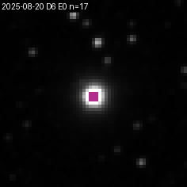 | 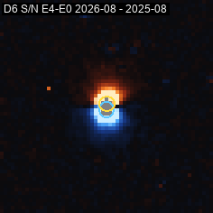 |

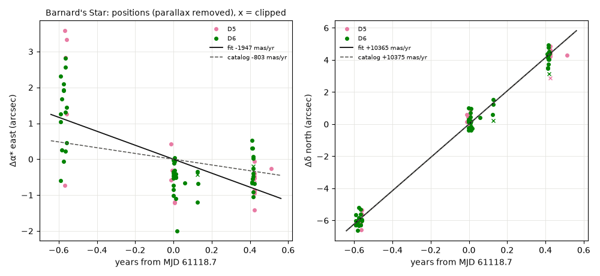

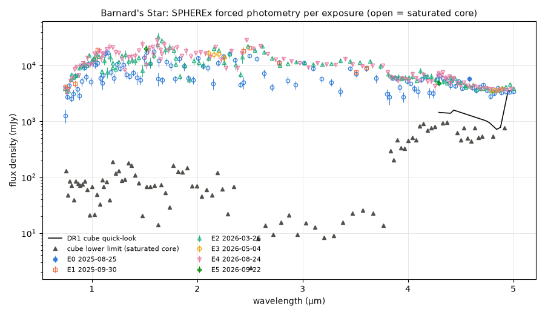

What else we learned:

- **One epoch is biased.** In E0 (August–September 2025) the saturated star's positions sit east of the prediction by +0.7 to +2.7″, depending on the detector (median per detector), with 1–2″ of scatter. This shows in all six detectors.
  - Field stars in the same co-adds agree with August 2026 to better than 0.08″, so the sky coordinates are fine and the bias is specific to the saturated star. August 2025 and August 2026 have the same orientation (`SPS_EPA` = 180), so it is not an orientation effect either.
  - The bias turns the fitted direction by −6° and puts the east-west component at −1,947 ± 239 mas/yr against Gaia's −803.
  - Averaging positions per epoch first gives 10,391 ± 280 mas/yr at PA 354.5°: ratio 0.999 and −1.1°.
  - We do not know the cause. E0 is also the epoch whose fluxes are 0.3–0.6 mag fainter in D1–D4 (next point).
- **Other measurements, for comparison only.**
  - D1–D4 (wing fits): 9,951 ± 187 mas/yr, ratio 0.956, −4.5°.
  - D5/D6 with the saturated core excluded entirely: 10,867 ± 278 mas/yr, ratio 1.044, −3.5°.
  - The residual scatter about the main fit is 0.95″. The reduced χ² is 10.7, so the scatter is about 3 times the formal errors; the quoted errors are scaled up to include this.
- **Saturated photometry is not stable between epochs.** Barnard's Star does not vary at this level, so we use it as a control. At matched wavelengths it appears to change from E0 to E4 by:

  | D1 | D2 | D3 | D4 | D5 | D6 |
  |---|---|---|---|---|---|
  | −0.44 ± 0.09 | −0.61 ± 0.12 | −0.51 ± 0.13 | −0.46 ± 0.10 | −0.21 ± 0.06 | −0.03 ± 0.04 mag |

  In D1, D4, D5 and D6 almost all of it happens between E0 and E2 (E2 → E4 changes by 0.05 mag or less); D2 and D3 keep changing until E4 (−0.34 and −0.29 mag).
- **The cube quick-look undershoots this star.** Only 9 of 100 cube channels are complete, and those read 0.26 times the Level-2 flux.

### 6.2 Epsilon Indi B: passes 5 of 5

| Criterion (fixed before the run) | Measured | Result |
|---|---|---|
| Proper motion within 5% of Gaia (all detectors) | 4,699 ± 16 mas/yr vs 4,685: ratio 1.003. 417 of 429 exposure positions used | Pass |
| Position angle within 3° | 121.51° vs 121.76°: −0.26° | Pass |
| Scatter of single-exposure positions under 0.5″ | 257 mas (east 198, north 165) | Pass |
| T-dwarf water absorption at 1.4 µm ≥ 5σ | 80% below the continuum, 26.8σ | Pass |
| T-dwarf methane absorption at 3.3 µm ≥ 5σ | 76% below the continuum, 65.6σ | Pass |

| Blink, D2 (1.1–1.65 µm) | Difference, D2, Oct 2026 − Oct 2025 |
|---|---|
| 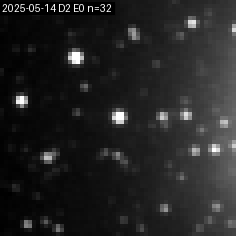 | 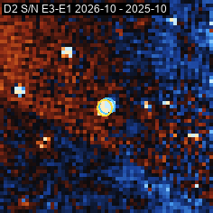 |

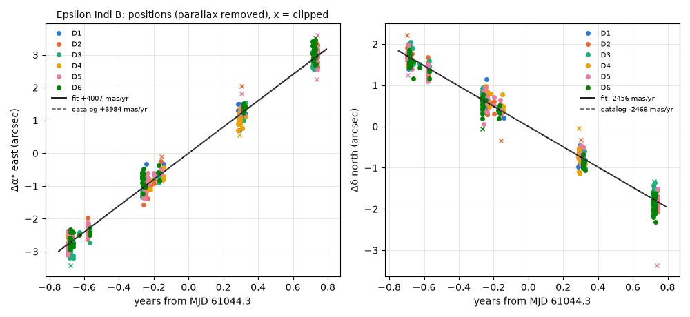

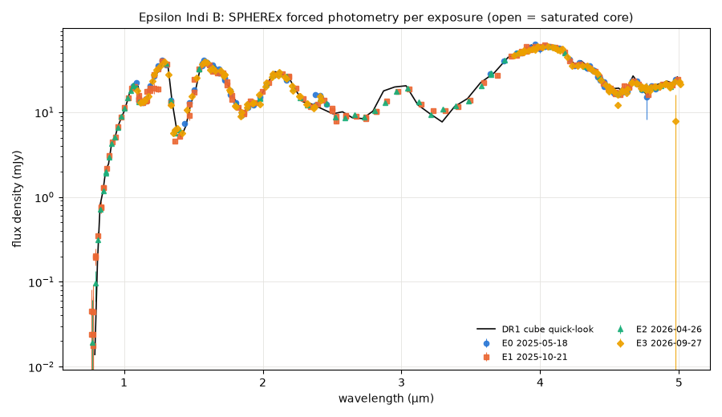

What else we learned:

- **The clean showcase.** Between the full epochs (October 2025 → October 2026, 352.5 days) the shift is 4.577 ± 0.027″, against 4.565″ predicted: 170σ, ratio 1.003, +0.2°. The difference images show the dipole at S/N +259/−238 (D2), +344/−264 (D3) and +249/−228 (D5).
- **A constant offset from the Gaia position.** The measured positions sit 0.20″ east and 0.54″ south of it, the same in every epoch and detector. Gaia measured the light centre of the unresolved Ba + Bb pair in visible light. Our tentative explanation is that the pair's light centre lies elsewhere in the infrared. The offset does not affect the motion.
- **The Level-2 spectrum matches the cube** within 5% in every detector.
- **Stable photometry.** Unsaturated photometry repeats between the full epochs to 0.03 mag or better: D2 −0.018 ± 0.023, D3 +0.030 ± 0.021, D5 +0.023 ± 0.008, D6 +0.012 ± 0.011 mag.
- **Limits.** The Year-2 epoch has no D1/D4 images. D1 and D4 differences therefore compare two partial epochs, and the D1 one is dominated by large-scale residuals; use D2, D3, D5 and D6. Each image cost 0.79 MB, because the detectors were rotated relative to north and stamps grew to cover the grid corners.

### 6.3 WISE 0855−0714: partial, 5 of 8

| Criterion | Fixed before the run? | Measured | Result |
|---|---|---|---|
| Detected at S/N ≥ 10 in the D5 + D6 co-add of each full DR1 epoch (aperture of radius 2 pixels; noise from 400 random apertures) | yes | 5.8 (Nov 2025), 6.9 (May 2026) | **Fail** |
| Not detected in D1–D4 (aperture \|S/N\| < 5) | yes | Up to 13.5 (D1, May 2026), because the aperture contains a neighbour star | **Fail** |
| Same detection test, with PSF photometry, the neighbour modelled and bootstrap errors | added after the first run | 8.7, 7.9 | **Fail** |
| Same non-detection test, with PSF photometry and the neighbour modelled | added after the first run | \|S/N\| ≤ 1.8 in every D1–D4 test | Pass |
| Shift rejects a static source at > 4σ, neighbour modelled (the planned primary measurement) | yes | May 2025 → May 2026 (360 days): 7.98 ± 0.77″, 10.3σ | Pass |
| Shift within 25° and 30% of the prediction, neighbour modelled | yes | 7.98″ vs 8.04″ predicted: ratio 0.99, −0.2° | Pass |
| Shift rejects a static source, neighbour ignored | yes | 6.59 ± 0.88″, 7.5σ | Pass |
| Shift within 25° and 30%, neighbour ignored | yes | Ratio 0.82, +0.5° | Pass |

Of the six rows fixed before the run, four pass.

| Blink, D5 + D6 (3.8–5.0 µm), per-epoch co-adds | Difference, D5 + D6, May 2026 − May 2025 |
|---|---|
| 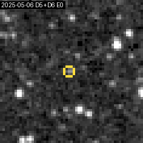 | 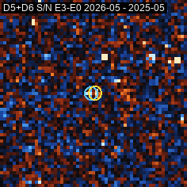 |

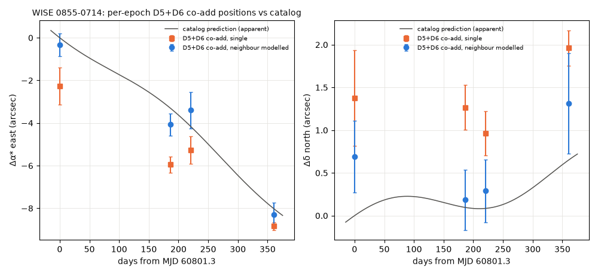

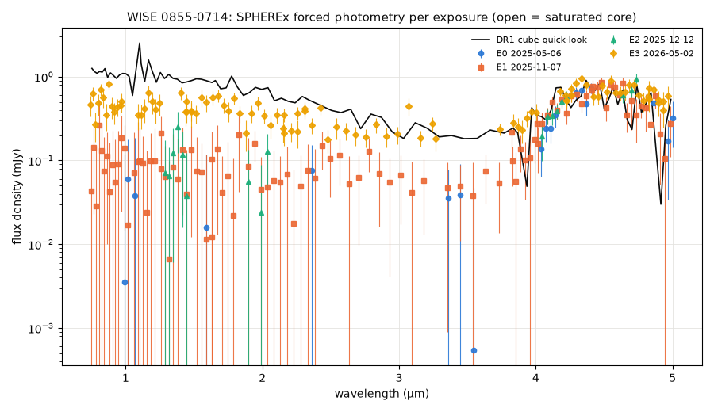

What we learned:

- **The motion is real and matches the prediction**, once the neighbour is modelled. The neighbour is the static CatWISE source J085501.95−071428.2 (W1 = 15.04, W2 = 15.20 mag). WISE 0855 approached it as it moved: 11.3″ apart in May 2025, 8.3″ in November, 7.5″ in December and 4.2″ in May 2026.
  - Fits that ignore the neighbour land 1.4–2.9″ from the predicted position; fits that model it land 0.7–0.8″ away.
  - A proper-motion fit through the four epoch co-adds gives 7,993 ± 825 mas/yr (ratio 0.98, −2.1°) with the neighbour modelled, and 5,711 ± 1,013 mas/yr (ratio 0.70) without it.
- **Whether WISE 0855 is "detected at S/N ≥ 10" depends on how the noise is estimated.** All four numbers below describe the same co-adds, for the November 2025 and May 2026 epochs:

  | Noise estimate | S/N (Nov, May) | What it includes |
  |---|---|---|
  | Aperture photometry, noise from random apertures on the co-add (neighbour not modelled) | 5.8, 6.9 | All noise: pixel noise, faint unresolved sources in 6″ pixels ("confusion"), correlations from resampling |
  | Bootstrap over exposures, neighbour modelled | 8.7, 7.9 | Conservative: it also counts the source's real brightness change across 3.8–5.0 µm as noise |
  | Pipeline VARIANCE, exposures fitted one by one, neighbour not modelled | 20.1, 30.4 | Pixel noise only |
  | Pipeline VARIANCE, co-add fit, neighbour modelled | 22.4, 18.9 | Pixel noise only, without the resampling correlations |

  Planning research measured 17–27 with noise from an annulus of pixels around the source. We consider the empirical numbers (6–9) the honest ones for a single epoch. The team needs to decide the criterion (§8).
- **Invisible in D1–D4**, as expected for such a cold object, once the neighbour is modelled. The single-exposure photometry and the spectrum at D1–D4 wavelengths measure the neighbour, not WISE 0855. That includes an apparent 1.0–1.7 mag "brightening" between the epochs, which is not real. The cube quick-look is 2–9 times brighter than our photometry below 3.85 µm for the same reason.
- **No Year-2 data yet.** QR3 has no images of this position so far.

### 6.4 RW Aurigae: partial, 1 of 2

| Criterion (fixed before the run) | Measured | Result |
|---|---|---|
| No measurable motion (\|μ\| < 3σ) | 518 ± 65 mas/yr toward PA 78° (7.9σ). Gaia: 27.5 mas/yr | **Fail** |
| Brightness change > 0.2 mag at > 5σ at matched wavelengths | D5 (3.83–4.40 µm) faded +0.86 ± 0.04 mag (22.9σ) between September 2025 and September 2026 | Pass |

Our criteria also ask for "strong infrared excess in the spectrum". The probe did not score it. A cross-check computed for this report shows it plainly: the flux density rises from 0.10–0.20 Jy at 0.75–0.90 µm to 1.3–2.9 Jy at 4.4–5.0 µm, a factor of 7–28 depending on the epoch. A bare stellar photosphere would be fainter at 4–5 µm than at 1–2 µm. The points are saturated, but their 0.2–0.6 mag systematics (§6.6) are small next to factors of 7–28.

| Blink, D5 (3.8–4.4 µm) | Difference, D5, Sep 2026 − Sep 2025 |
|---|---|
| 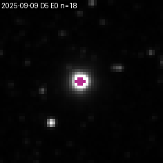 | 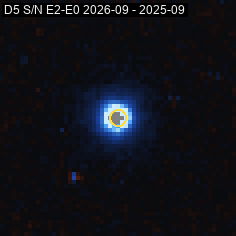 |

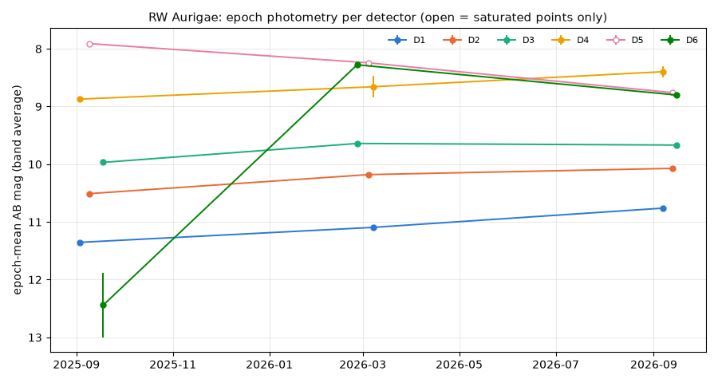

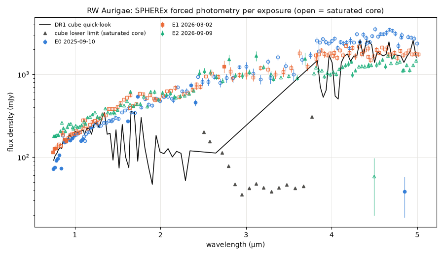

What we learned:

- **Brightness change at matched wavelengths**, September 2025 → September 2026:

  | D1 | D2 | D3 | D4 | D5 | D6 |
  |---|---|---|---|---|---|
  | −0.48 ± 0.07 | −0.30 ± 0.02 | −0.08 ± 0.04 | +0.06 ± 0.08 | **+0.86 ± 0.04** | **+0.84 ± 0.06** mag |

  - The fading at 3.8–5.0 µm is 4–25 times larger than the Barnard's Star control in D5 and D6 (−0.21 and −0.03 mag), so it is real.
  - The brightening in D1 and D2 lies within the control's range in D1–D4 (−0.44 to −0.61 mag), so we do not claim it.
  - 306 of 335 exposures are saturated, so no unsaturated comparison was possible.
- **The null test fails because of the companion, as far as we can tell.**
  - RW Aur B lies 1.52″ from A at PA 74°, unresolved in 6″ pixels. The measured positions are offset from the Gaia position of A toward PA 70° on average, close to the direction of B, and the fitted "motion" points to PA 78°.
  - The offsets are largest in the epochs after A faded at 3.8–5.0 µm, up to +1.6″ east and +0.8″ north. That is what the light centre of an unresolved pair does when one star fades.
  - But the D1–D3 offsets also grew while A brightened there. The light centre also depends on B, which we cannot measure separately, so we call the explanation likely, not proven. A null test for this target needs the companion modelled, or a test across the A–B axis.
- **The epoch-mean light curve has an outlier.** In the figure, D6 in September 2025 sits at 12.4 mag against 8.3–8.8 later. The epoch-mean rule prefers unsaturated points; that epoch had one, at 4.85 µm, and it is a poor measurement. The matched-wavelength comparison above does not use this rule.

### 6.5 R Draconis: passes 5 of 5

| Criterion | Fixed before the run? | Measured | Result |
|---|---|---|---|
| 100% of exposures flagged saturated | yes | 842 of 842 (840 measured from the wings of the star image) | Pass |
| Epoch brightness ordered as the pulsation phase predicts (ring 3–6 pixels from the centre) | yes | 3 usable wide-survey epochs in the predicted order | Pass |
| 246.12-day sinusoid detected, maximum within 0.25 cycle of the catalogue (VSX) maximum (3–6 px ring) | yes | Amplitude 0.68 ± 0.11 mag (6.2σ), maximum at phase 0.04, from 51 usable exposures. Rank correlation with phase: p = 4 × 10⁻⁸ | Pass |
| Epoch order, ring 8–12 pixels | robustness variant, added after the first run | All 4 wide-survey epochs in the predicted order (mean phases 0.12, 0.78, 0.41, 0.62; brightness change −0.31, +0.02, +0.44, +0.38 mag) | Pass |
| Sinusoid, ring 8–12 pixels | robustness variant, added after the first run | Amplitude 0.355 ± 0.018 mag (19σ), maximum at phase 0.03, 839 exposures, p = 2 × 10⁻⁸⁰ | Pass |

| Blink, D3 (1.6–2.4 µm), 30-day bins | Light curves: epoch means (top) and the outer-ring light curve with the fitted sinusoid (bottom) |
|---|---|
| 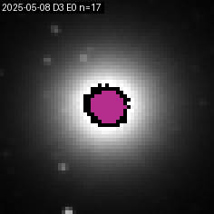 | 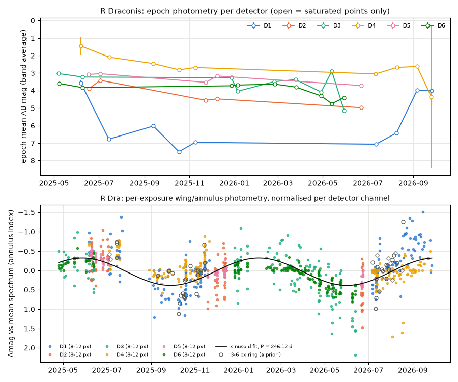 |

What we learned:

- **Fitting the star image fails here.** The core and the inner wings are saturated or bloomed. The epoch means from star-image fits jump by 3–4 mag in D1 (top panel), which is meaningless.
- **The planned ring is mostly flagged.** The 3–6 pixel ring is covered by BLOOM, TRANSIENT or SUR_ERROR in 82–94% of exposures, so only 51 exposures are usable.
- **The outer ring works.** The 8–12 pixel ring, chosen after seeing this and reported separately, gives a clean 839-point light curve. Its maximum falls at phase 0.03 of the catalogue ephemeris (period 246.12 days, maximum at JD 2457370).
- **This is the one required target with a real light curve**, thanks to the deep-field cadence (§5.4).
- **Motion is not measurable.** The motion fit is a diagnostic only, with 1.45″ residual scatter. The cube quick-look has no complete channel (82 lower limits).

### 6.6 Saturation and faintness: what we can and cannot measure

**Saturation.** Three of the five targets saturate the detectors. The flags in our runs tell the story: Barnard's Star 357 of 358 exposures, RW Aurigae 306 of 335, R Draconis 842 of 842.

[`config.py`](../backend/src/pxh/config.py) lists the saturation onset from the mission's Explanatory Supplement v2.1: AB magnitude 11.5 in D1–D3, 11.3 in D4, 10.2 in D5 and 9.75 in D6. The data agree with it. Barnard's Star's epoch means are AB 5.6–7.5, far brighter. RW Aurigae sits at AB 10.8–11.4 in D1, right at the onset, and only 37 of its 56 D1 exposures are saturated. In D5, at AB 7.9–8.8, all 56 are.

- **Positions can survive saturation.** SPHEREx samples each pixel many times during an exposure, and fits the slope of that ramp on board. When a pixel overflows, the fit stops early but keeps a valid slope from the first samples. The pipeline's VARIANCE accounts for the fewer reads.
  - Our photometry therefore uses saturated-core pixels whose only flags are OVERFLOW, TRANSIENT, SUR_ERROR or BLOOM, each with its variance. It never uses "early overflow" (OVERFLOW together with SUR_ERROR).
  - With this, Barnard's Star's proper motion comes out within 1.3% of Gaia. Fitting only the unflagged wings is biased: in D6 it gave a flux 21% high.
- **Photometry of saturated stars is not stable between epochs.**
  - The Barnard's Star control changes by 0.2–0.6 mag in D1–D5 at matched wavelengths, while the star itself is steady.
  - Light curves and spectra of saturated stars must carry a low-confidence label. Only changes well beyond this floor count: RW Aurigae's +0.86 mag in D5 qualifies, its −0.3 to −0.5 mag in D1–D2 does not.
- **Very bright stars need ring photometry.** For R Draconis only a ring 8 or more pixels from the centre works.
- **The cube quick-look cannot be trusted on bright stars.** It reads too faint by a factor of up to 5 on RW Aurigae (1.65–2.45 µm), even in channels it marks complete (§3).
- **The UI must say so.** Every saturated measurement is labelled. The saturated cores are masked in co-adds and shown as a magenta overlay in blinks.

**Faintness.** WISE 0855 is the faint test.

- A single exposure in D5 or D6 reaches a median S/N of only about 4–5 (D5 4.6, D6 4.1). In D1–D4 it is 0.9–1.7, consistent with no detection.
- Co-adding one epoch's 36–37 D5 + D6 exposures gives S/N 6–9 with empirical noise. Two things limit it: confusion with faint sources in 6″ pixels, and a W2 = 15.2 neighbour that comes within 4.2″ (less than one pixel).
- Motion is still detected at 10σ, because the 8″ shift is 1.3 pixels and we fit positions with the neighbour modelled.
- For faint movers in crowded fields, the app needs neighbour-aware fits and noise estimated from the image itself, not from the pipeline variance alone.

---

## 7. Where the brief met the data

The challenge brief and our plan made assumptions that the data partly contradict. Phase 1 tested them:

| The brief assumed | What the data show (Phase 1) | Decision |
|---|---|---|
| Blink a time series of images | Each raw exposure catches the target at a different wavelength. Within one epoch a detector sweeps its whole band; for example, Barnard's Star's D1 E0 spans 0.750–1.107 µm across 19 exposures | **Blink per-epoch, per-detector co-adds** (zodiacal light subtracted, flags masked, inverse-variance weighted, shared north-up grid). Same-channel blinks and single-exposure "burst" frames become extra modes |
| 102 bands, like 102 images | Every pixel has its own wavelength. The 102 channels exist only in the Level-3 cube | **Wavelength slider** on the DR1 cube. Per-detector co-adds and false-colour images rendered by the backend |
| Spectra on the fly for any position | The cube quick-look takes 1.2–3.0 s (planned: about 1 s). It agrees within 5% with Level-2 photometry for a clean source, but reads about 4–5 times too faint on saturated stars and blends neighbours within its 12.9″ pixels | **Two tiers.** Tier A, the cube quick-look, labelled as such, with automatic warnings for lower limits, saturation and close neighbours. Tier B, science spectra fitted in every exposure, precomputed for the five targets |
| Light curves | Wide-survey positions get 3–6 epochs (2–3 full) over 1.0–1.4 years. Only deep fields have real light curves (R Draconis: 17 bins). Epoch means can mislead (§6.4) | **Epoch photometry** in wide fields; **matched-wavelength comparisons** for variability claims; full light curves in deep fields |
| The test targets behave like ordinary stars | Three of five saturate. Positions still work, but photometry of saturated stars carries 0.2–0.6 mag epoch-to-epoch systematics. R Draconis needs ring photometry 8 or more pixels out | **Saturation-aware measurement**, explicit badges, and per-target criteria |
| Contamination flags can simply be masked | The bit table is per file. SOURCE covers most pixels in crowded fields *(from planning research)*. SNOWBALL is missing from 29 DR1 headers | **Mask the invalid and artifact groups** by name; keep SOURCE and DICHROIC; overlay the groups; add a known-bit fallback for SNOWBALL |
| "No motion" for a non-moving star | A variable, unresolved binary (RW Aurigae) shows an apparent 0.5″/yr motion toward its companion | **Label this case in the UI**. Model companions, or test motion across the pair's axis |
| A faint brown dwarf is easy to detect in stacks | WISE 0855 reaches S/N 6–9 per full epoch with empirical noise, or 19–30 with pipeline noise | **Report empirical S/N**, show both, and decide the criterion (§8) |
| Name lookups work (SIMBAD and friends) | CDS is degraded, and "WISE 0855−0714" resolves in no name service *(from planning research)* | **Local alias table first**, then mirrors. All five targets resolved locally |
| Large fields of view | Per-image cost grows with the rows a stamp spans (flags) and with its area (pixels). Phase 1 used 6′ fields at 0.5–0.8 MB per image | **Keep live blinks small.** Phase 1 used 6′; the API contract allows 2–30′ with a 10′ default. Larger views fall back to the all-sky cube |

Three topics remain untested by Phase 1:

- asteroids, which are found within one epoch, across visits a few orbits apart;
- the "Planet X" framing, which keeps the planet hunt as the hook and sells real finds;

---

## 8. Open issues and next steps

### Decisions for the team

1. **WISE 0855 detection criterion.** S/N ≥ 10 per full epoch fails with empirical noise (6–9) and passes with pipeline noise (19–30). Our recommendation: show the empirical S/N in the UI and state the noise model next to it.
2. **RW Aurigae null test.** Model RW Aur B, or test motion only across the A–B axis. In the UI, explain that the light centre of an unresolved pair moves when one star varies.
3. **Default motion estimator for saturated stars.** For Barnard's Star, the epoch-means fit (−1.1° from Gaia) is more robust than the per-exposure fit (−6.2°), which the August 2025 bias pulls.
4. **Confidence labels for saturated photometry.** Use the Barnard's Star control (0.2–0.6 mag in D1–D5) as the systematic floor, and claim variability only beyond it.
5. **Epsilon Indi B's constant 0.57″ offset from Gaia.** Explain it in the UI (light centre of the pair) or leave it out.

### Known data issues

- **Barnard's Star, August 2025:** saturated-star positions biased +0.7 to +2.7″ east and fluxes 0.3–0.6 mag low in D1–D4. Field stars are fine. Cause unknown.
- **Orientation offsets:** field stars shift by 0.11–0.25″ east between surveys of opposite orientation (Barnard's Star). RW Aurigae's D6 shows −0.7 and −0.9″ from only 4–5 matched stars; this needs checking.
- **SNOWBALL** (bit 27) is undefined in 29 DR1 file headers. Add a known-bit fallback in `pxh.spherex.flags`, like the one for SATELLITE_HALO.
- **The cube quick-look misleads on saturated or blended sources** (§3). Tier A must warn automatically.
- **The epoch-mean rule can promote a single bad point** (RW Aurigae D6, September 2025). Show the number of points with each epoch mean, or use matched-wavelength comparisons in the UI.
- **Incomplete epochs:** not every full epoch samples all 17 channels (43 of 58 detector-epochs do), so missing channels should be shown, not interpolated.
- **Unscored criterion:** RW Aurigae's infrared excess was not scored. Add it as a check.
- **No Year-2 data for WISE 0855 yet.** The release poller should pick it up when QR3 covers it.

### Engineering for Phases 2–3

- **Static bundles.** Build the five target bundles (`frontend/public/bundles/<slug>/`, docs/api-contract.md) from these runs. The demo must not depend on IRSA.
- **Live endpoints.** Turn the probe's stages into the endpoints `/api/field/summary`, `/api/field/stream` and `/api/spectrum/*`.
- **Cheaper reads.**
  - Cache the cube quick-look pixels, which cost 0.25 MB per call today.
  - Decode only the needed prefix of each compressed flags row. This is not implemented yet and could roughly halve the cost of a stamp.
- **Keep the retry policy.** IRSA's file server returned bursts of HTTP 503 during the R Draconis run.
- **Weekly release check.** Poll the collection list and the latest observation per field (§2.2).
- **Link this report** from the README and the How-it-works page.

---

*How this report was made: the measurements come from `scripts/phase1_probe.py`, run on the five targets on 14 November 2026 (outputs in `docs/phase1/`).*

*Data: SPHEREx, NASA/JPL-Caltech, served by the NASA/IPAC Infrared Science Archive (DR1 images doi:10.26131/IRSA678, DR1 spectral cube doi:10.26131/IRSA679, Quick Release 3). Astrometry from Gaia DR3 (ESA/Gaia/DPAC) and, for WISE 0855−0714, Kirkpatrick et al. 2021 (ApJS 253, 7). Neighbour photometry from CatWISE2020.*
