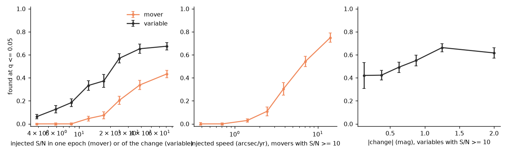
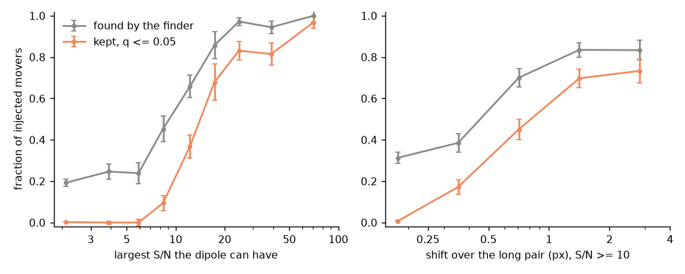
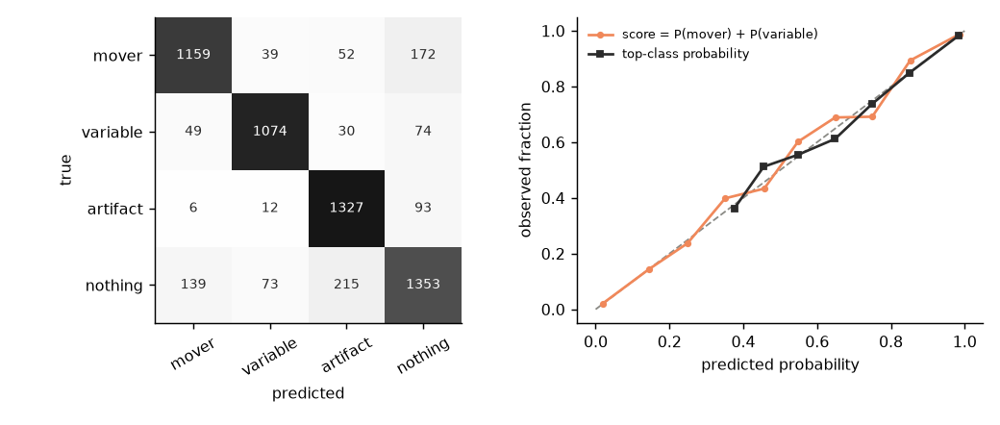
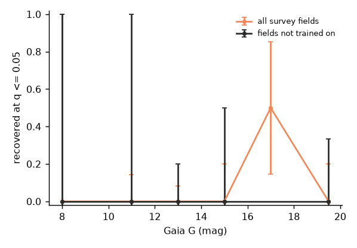

# Mover and variable finder: validation

*Measured on 2026-11-14 with the finder `movers-1` and the classifier `realbogus_v1` (trained that evening).
Every number below is in [`movers_metrics.json`](movers_metrics.json), written by
[`ml/movers/evaluate.py`](../../ml/movers/evaluate.py); the survey list is
[`frontend/public/discoveries/candidates.json`](../../frontend/public/discoveries/candidates.json), written by
[`scripts/run_discovery.py`](../../scripts/run_discovery.py).*

## In plain words

The finder subtracts an early SPHEREx image of a patch of sky from a later one and looks for what changed. A
star that moved leaves a dark spot where it was and a bright spot where it went; a star that changed brightness
leaves a single spot. A small neural network then looks at each spot and says how much it looks like a real
mover or variable rather than an imaging artifact, and a statistical test (the false-discovery rate) decides
which ones to report.

- **Fast movers are found; slow ones mostly are not, and that is the images, not a bug.** SPHEREx pixels are
  6.15 arcseconds wide and the survey's epochs span half a year to a little over a year. A star moving
  1 arcsecond a year shifts by a sixth of a pixel or less, which leaves almost nothing in the difference image.
  Of synthetic movers that shift by at least one pixel and are bright enough (S/N of at least 10), **70 to 73%
  are reported**; of those that shift by less than a quarter of a pixel, 1% are. Counting every speed from 0.3 to 20 arcseconds a year, the figure is
  27% at S/N 10 or more.
- **Synthetic brightness changes** with S/N of at least 10 are reported 55% of the time, rising to 67% at S/N
  50 to 100.
- **False alarms are rare.** On the held-out fields, nothing was reported outside the known object at each field's
  centre: 0 false alarms in 0.25 square degrees, so at most 12.2 per square degree (95% upper limit). Of 540
  synthetic stars that did not change, 3 were reported.
- **Challenge targets.** Searched as known positions, Epsilon Indi B is found as a mover with a measured motion
  of 4.30 ± 0.39 arcseconds a year (catalogue: 4.68), and WISE 0855-0714 is found as a faint mover-like spot.
  Barnard's Star, R Draconis and RW Aurigae are saturated in nearly every image (357 of 358, 842 of 842 and 306 of
  335); the automatic finder does not detect them (RW Aurigae just misses, at q = 0.051). The hand-made Phase 1
  measurements of these stars in single exposures, which keep the saturated core's pixels that still hold a valid
  early-ramp slope (and, for R Draconis, use a ring 8 to 12 pixels from the centre), are the reliable ones
  ([`docs/data-findings.md`](../data-findings.md)).
- **The survey list** (53 fields, 1.47 square degrees) reports 2 candidates at q ≤ 0.05, both known objects: the
  ultracool dwarf SSSPM J1444-2019, moving 3.66 ± 0.43 arcseconds a year (catalogue: 3.51), and a possible
  brightening of the ultracool dwarf 2MASS J13243553+6358281 that forced photometry does not confirm (1.4σ). A
  further 16 candidates are listed at 0.05 < q ≤ 0.2. No new mover is claimed.

## What was tested, and on what

The survey's 53 finished fields (`data/survey`, real SPHEREx co-adds per epoch, detectors D4-D6, 99 × 99 pixels of
6.15″, 0.028 square degrees each) are split by field: 31 for training, 8 for validation (calibration and the
null scores for the p-values), 9 for testing, and the five challenge targets, which are never trained on
([`split.json`](../../ml/movers/split.json)). Every number here comes from test fields or targets unless it says
otherwise.

The pipeline is the deployed one ([`pxh.ml.finder`](../../backend/src/pxh/ml/finder.py)):

1. S/N difference images (latest minus earliest full epoch, and each pair of adjacent full epochs), each divided by
   its own measured scatter; peaks of at least 5 sigma; a positive and a negative peak in the same pair make a
   mover candidate, any other peak a variable candidate.
2. The classifier gives P(mover), P(variable), P(artifact), P(nothing) from a 4 × 21 × 21 pixel stamp; the score
   is P(mover) + P(variable). Test-stamp accuracy is 83.7% (5,867 stamps); after temperature scaling
   (T = 1.30) the validation calibration error is 0.013.
3. The p-value is the fraction of 3,400 null scores (425 real validation-field candidates in their 8 orientations)
   at least as high; q-values are Benjamini-Hochberg over the candidates of one field. A candidate is reported at
   q ≤ 0.05.

## Completeness: synthetic sources in real test images

Synthetic sources were added to the real co-adds of the 9 test fields, 30 times per field (1,080 movers, 1,080
variables and 540 steady stars), and each field was then searched exactly as the website searches it.
Movers have speeds from 0.3 to 20″/yr (log-uniform) and S/N per epoch from 3 to 100; variables change by
0.3 to 3 times in flux.



| S/N per epoch | Movers reported | Variables reported (S/N of the change) |
|---|---|---|
| 3-5 | 0/153 (0%) | 9/142 (6%) |
| 5-7 | 0/105 (0%) | 14/110 (13%) |
| 7-10 | 0/124 (0%) | 24/130 (18%) |
| 10-15 | 5/108 (5%) | 44/132 (33%) |
| 15-20 | 6/80 (8%) | 28/75 (37%) |
| 20-30 | 27/132 (20%) | 82/144 (57%) |
| 30-50 | 49/145 (34%) | 94/144 (65%) |
| 50-100 | 101/233 (43%) | 137/203 (67%) |
| **10 or more** | **188/698 (27%)** | **385/698 (55%)** |

Movers with S/N ≥ 10, by speed: 0.3-1″/yr 0/187, 1-2″/yr 4/135 (3%), 2-3″/yr 7/64 (11%), 3-5″/yr 22/72 (31%),
5-10″/yr 65/120 (54%), 10-20″/yr 90/120 (75%). Variables with S/N ≥ 10, by the size of the change: 42% for
0.25-0.5 mag, 55% for 0.75-1 mag, 66% for 1-1.5 mag.

### Why mover completeness is low at S/N 10

A mover completeness of 19-27% at S/N 10 looked too low, so the losses were traced injection by injection. Three
possible causes were checked:

- **Sub-pixel motion (the main cause).** For a point source of width σ that shifts by d, the difference image can
  hold at most S/N × √(1 − exp(−d²/4σ²)) of signal: all of it once the two images separate, but only about
  S/N × d/(2σ) for a small shift. With σ ≈ 0.7 px, a shift of 0.2 px keeps 14% of the S/N. Over the test fields'
  baselines, **61% of the movers with S/N ≥ 10 shift by less than half a pixel**. Measured against the S/N their
  dipole can have, the finder behaves as a 5-sigma detector should: it finds 87% of movers whose dipole can reach
  S/N 10 and all 32 whose dipole can reach S/N 50.

  

  | Largest S/N of the dipole | Found by the finder | Reported (q ≤ 0.05) |
  |---|---|---|
  | below 5 | 140/688 (20%) | 1/688 (0%) |
  | 5-10 | 45/131 (34%) | 6/131 (5%) |
  | 10-15 | 50/76 (66%) | 28/76 (37%) |
  | 15-20 | 24/28 (86%) | 19/28 (68%) |
  | 20-50 | 120/125 (96%) | 103/125 (82%) |
  | 50-100 | 32/32 (100%) | 31/32 (97%) |

  | Shift over the long pair (S/N ≥ 10) | Found | Reported |
  |---|---|---|
  | under 0.25 px | 96/307 (31%) | 2/307 (1%) |
  | 0.25-0.5 px | 47/122 (39%) | 21/122 (17%) |
  | 0.5-1 px | 70/100 (70%) | 45/100 (45%) |
  | 1-2 px | 91/109 (83%) | 76/109 (70%) |
  | 2-4 px | 50/60 (83%) | 44/60 (73%) |

  The "found" fraction below dipole S/N 5 is not detections of the motion: it counts any candidate within 2 px,
  such as the residual of a star the mover passes.
- **The detection threshold.** Not the main cause: at 5 sigma per pixel the finder finds most dipoles that can
  reach S/N 10. A lower threshold would find more of the dipoles between S/N 5 and 10 (34% found now), but it
  would also add noise peaks to every field's family of about 60 candidates, which makes the false-discovery step
  stricter for everything else. It was left at 5 sigma.
- **Dipole pairing for sub-pixel motions.** When a mover is found, the finder pairs its two lobes 62% of the time;
  otherwise it reports a single peak. This does not lose the mover: the classifier decides the kind from the
  stamp, and 99% of reported movers get the right kind.

What remains between "found" and "reported" for well-separated dipoles (87% found, 69% reported at dipole S/N ≥ 10)
is the false-discovery step: a field has about 60 candidates, so the first one reported needs a p-value below
0.05/60, which means scoring higher than all but one or two of the 3,400 null scores. More null scores would
loosen this; they need more validation fields.

**Injection realism.** The synthetic sources use a Gaussian core with faint wide wings, the width measured in
each co-add, and noise consistent with the co-add's weights; bright ones saturate and are masked like real stars.
Real stars still differ in detail (the PSF is undersampled and changes across the detector), so these numbers are
for sources like the synthetic ones. The known fast stars below are the check on real objects.

## False alarms on real fields

Each held-out field was searched as is, with nothing added.

| Fields | Area | Reported at q ≤ 0.05 | False alarms per square degree |
|---|---|---|---|
| Control fields ctrl-03 and ctrl-05 (random sky) | 0.056 deg² | 0 | 0 (95% upper limit 54) |
| All 9 test fields, outside 45″ of the object at each centre | 0.247 deg² | 0 | 0 (95% upper limit 12.2) |

In the synthetic test, 3 of 540 steady stars (0.6%) were reported, all brighter than S/N 30: the residual a bright
star leaves when two epochs are registered to 0.1-0.25″ rather than exactly.

## Classifier stamps



| True class (test stamps) | Called mover | variable | artifact | nothing | Right |
|---|---|---|---|---|---|
| mover (1,422) | 1,159 | 39 | 52 | 172 | 82% |
| variable (1,227) | 49 | 1,074 | 30 | 74 | 88% |
| artifact (1,438) | 6 | 12 | 1,327 | 93 | 92% |
| nothing (1,780) | 139 | 73 | 215 | 1,353 | 76% |

Movers and variables are rarely called artifacts; the main confusion is with "nothing" (stamps with no change),
which is where faint and sub-pixel movers sit.

## The challenge targets

Each target field was searched like any other (blind: q over the whole field) and, because the target's position is
known in advance, also as a **targeted test**: only the candidates within 30″ of the target's predicted position
form the family. Positions are moved to the latest epoch with the catalogue proper motion.

| Target | Expected | Nearest candidate | Blind q | Targeted q | Result |
|---|---|---|---|---|---|
| Epsilon Indi B | mover | dipole 0.6″ away (position from its motion fit), S/N 143, P(mover) 0.65 | 0.26 | **0.010** | **Found as a mover.** Motion 4.30 ± 0.39″/yr at 125° (catalogue 4.68″/yr at 122°) from 10 positions in 4 epochs |
| WISE 0855-0714 | mover | single 6.4σ peak 5.2″ away, P(mover) 0.46, P(nothing) 0.36 | 0.40 | **0.031** | **Found as a mover-like spot**, too faint for a motion fit |
| Barnard's Star | mover | 16″ away, S/N 276, saturated and masked core | 0.36 | 0.055 | Not found: the core is masked, and the wings' residual reads as a variable (0.26) or nothing (0.35) |
| RW Aurigae | variable | 15″ away, S/N 272, saturated and masked core, P(variable) 0.77 | 0.22 | 0.051 | Not found (just misses); forced photometry gives +0.58 mag at 0.8σ |
| R Draconis | variable | none within 30″ | - | - | Not found: saturated in every exposure |

The live path gives the same answer: `/api/candidates` at Epsilon Indi B's 2026 position, building the co-adds
from the archive in 37 s, lists it as a mover moving 4.35 ± 0.33″/yr at 126° (Gaia DR3 6412596012146801152), at
a whole-field q of 0.13 (78 candidates in the field).

The survey run writes the same targeted tests, with the best candidate's stamp, to the `targets` section of
`candidates.json`. There Epsilon Indi B matches SIMBAD's eps Ind B and WISE 0855-0714 matches
WISEA J085510.74-071442.5.

Barnard's Star, R Draconis and RW Aurigae are far brighter than the finder's working range: their cores saturate,
so the co-adds mask them and only the wings change. The Phase 1 analysis measured them in single
exposures: Barnard's Star moves 10.55 ± 0.12″/yr (Gaia: 10.41) in fits that keep the saturated core's pixels that
still hold a valid early-ramp slope, and R Draconis pulsates with 0.355 ± 0.018 mag in a ring 8 to 12 pixels from
its centre ([`docs/data-findings.md`](../data-findings.md)). The automatic finder does not replace that analysis for
saturated stars.

## The survey run

[`scripts/run_discovery.py`](../../scripts/run_discovery.py) searched all 53 finished fields (1.47 deg²): 3,919
candidates, of which 3,156 are in the families (the rest touch the field edge or a coverage gap). q-values are
computed **within each field**, exactly as the Lab and `/api/candidates` compute them, so a candidate has the same q
in both. A single family for the whole survey cannot work with this null set: with 3,156 candidates and the
smallest possible p-value of 1/3,401, the smallest q for one candidate is 0.93. What per-field families leave over
the whole list is the false-alarm rate above: at most 12.2 per square degree, so at most about 18 over the
survey's 1.47 square degrees at the 95% limit, and none were seen in the test fields.

Mover candidates whose own position fit shows no significant motion (none, or below 3σ) and which sit within 9″
of a bright star (G ≤ 16 or W1 ≤ 14) that Gaia or CatWISE measured as static are left out as registration
residuals of that star ([`static_star_residual`](../../backend/src/pxh/ml/finder.py)). This removed 4 candidates:
two at q = 0.034 in the RW Aurigae field (dipoles on static stars of G = 13.9 and 15.1, with a measured motion of
1.2 ± 0.8″/yr and none) and two at q = 0.195 in the V2586 Ori field.

| q ≤ 0.05 | Field | Kind | Match | Measured |
|---|---|---|---|---|
| bd-ssspm-j1444-2019-000 | training | mover, S/N 88 | SSSPM J1444-2019 (SIMBAD; Gaia 3.51″/yr), 0.2″ | 3.66 ± 0.43″/yr |
| bd-2mass-j13243553p6358281-000 | training | variable, S/N 17 | 2MASS J13243553+6358281 (SIMBAD), 1.0″ | −0.32 mag, but only 1.4σ in forced photometry |

Both are in training fields, and the classifier saw their real candidates during training (the SSSPM J1444-2019
dipole as a mover example), so they show that the pipeline works end to end, not how well it generalises; the test
fields above do that. The other 16 listed candidates (0.05 < q ≤ 0.2) include 12 in the V2586 Ori field, a crowded
star-forming region where many stars vary.

### Known fast stars in the survey fields

Each known-mover and brown-dwarf field has a catalogued fast star at its centre (31 fields, 0.65-3.5″/yr). A
candidate lies within 12″ of the star in 25 of them, but only SSSPM J1444-2019 (3.5″/yr) is reported as a mover
(blind q = 0.033, targeted q = 0.0006). At L 127-97 a candidate passes the targeted test but is called a
variable. The others move 0.65-2.0″/yr, under half a pixel over the baselines: the regime where synthetic movers
are reported 1-17% of the time. In all, 501 catalogued stars faster than 0.5″/yr lie in the fields; most are
faint CatWISE sources whose motions SPHEREx cannot see, and several near Barnard's Star are spurious catalogue
motions in its glare.



## Limitations

- Motions below about 3″/yr are out of reach with a one-year baseline at 6.15″ pixels, unless the star is very bright
  and unsaturated. A longer baseline (more SPHEREx epochs) helps linearly.
- Saturated stars are masked; the finder sees only their wings.
- The null set has 425 real candidates from 8 validation fields. More validation fields would allow smaller
  p-values and so more reported candidates per field.
- Registration between epochs (0.1-0.25″) leaves dipoles on bright static stars; the classifier rejects most of
  them, and the static-star check above removes the rest from the survey list.
- Candidates are unconfirmed until checked against the Lab's per-exposure measurements or other data.

## Reproduce

```
cd ml
uv run python movers/make_dataset.py --train-reps 100 --eval-reps 40   # about 4 minutes, 12 workers
uv run python movers/train.py                                           # about 15 minutes on CPU
uv run python movers/evaluate.py --reps 30                              # about 2 minutes
uv run python ../scripts/run_discovery.py                               # about 2 minutes
uv run python movers/evaluate.py --parts known                          # needs the survey run
```
