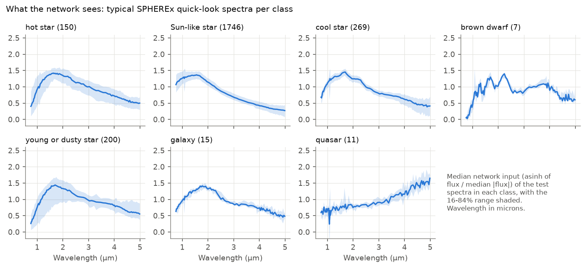
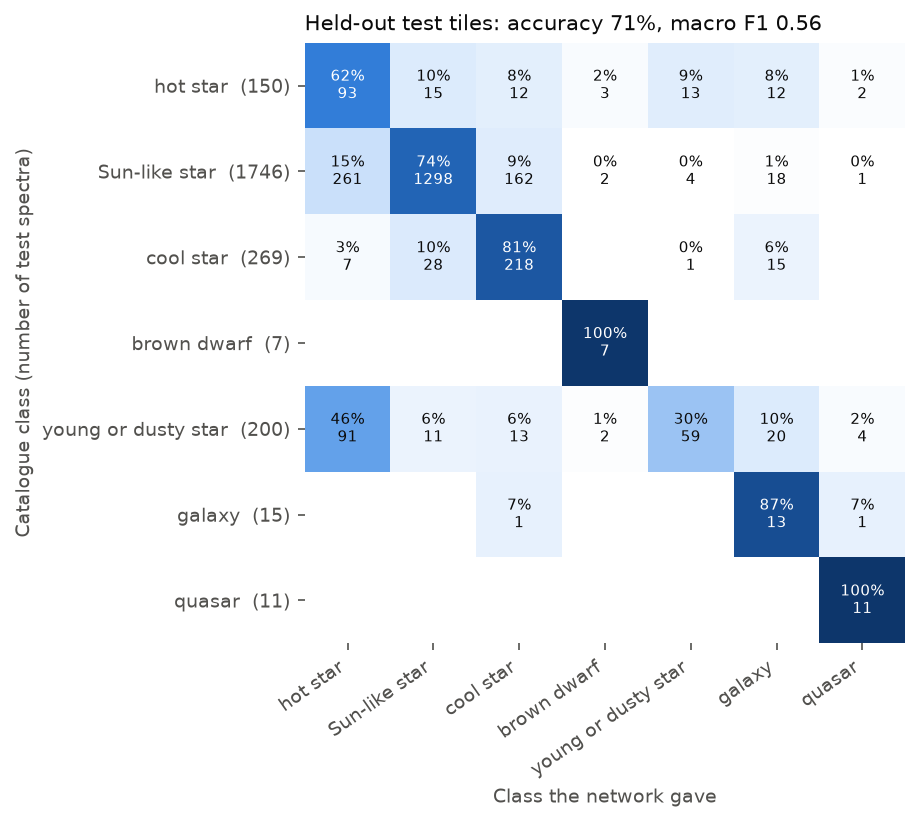
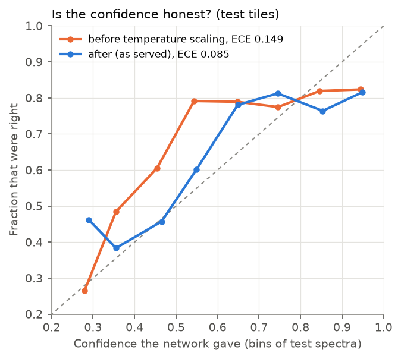
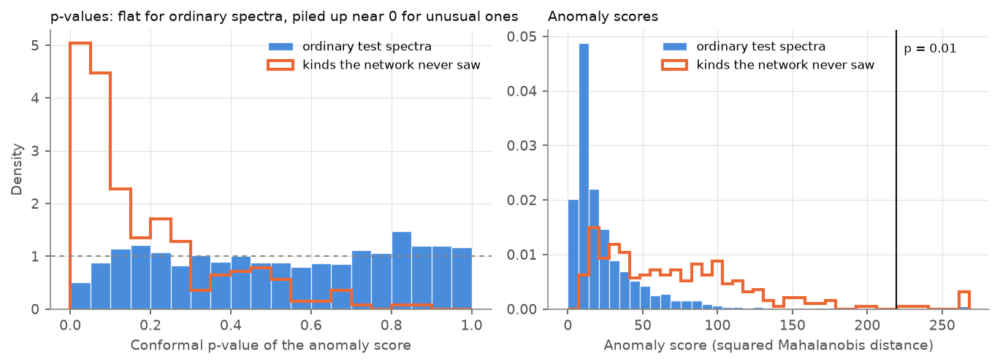
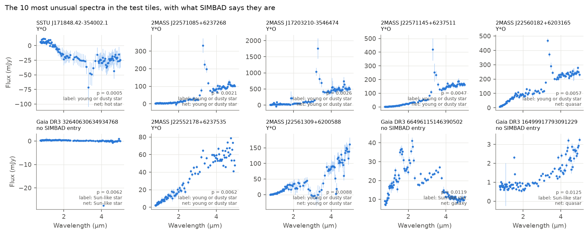
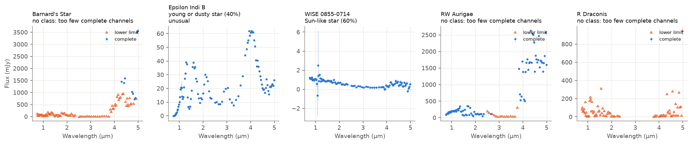

# Spectral classifier `specclass-v1`: validation

*Written by `ml/spectra/report.py` from the measured results of `ml/spectra/train.py` (run of 2026-11-14). Seed 20261114.*

## In plain words

Planet X Hunter reads the SPHEREx quick-look spectrum at any spot (102 colours of infrared light, from the DR1 all-sky cube) and says what kind of object it looks most like: a hot star, a Sun-like star, a cool star, a brown dwarf, a young or dusty star, a galaxy or a quasar. A small neural network makes that call. It learned from real SPHEREx spectra of objects that SIMBAD and Gaia had already classified, and it was tested on parts of the sky it never saw during training.

- On 5,647 test spectra from 43 held-out sky tiles it picked the catalogue's class **76%** of the time (90% range over tiles: 69% to 83%). Averaged over the seven classes equally (macro F1) it scores **0.64** (0.55 to 0.70).
- It finds most of the galaxies, quasars and brown dwarfs in the test tiles (93%, 86% and 86%), and fewest of the cool stars and young or dusty stars (72% and 60%). The rare classes have few test spectra, so their numbers are uncertain (see the table below).
- Its biggest mix-up: 30% of the young or dusty stars in the test tiles were called hot stars.
- Its confidence can be taken at face value: after calibration, the expected calibration error (the average gap between the confidence it states and how often it is right) is 0.025 (0.024 before calibration).
- It also flags **unusual spectra**. On ordinary test spectra the flag fires 0.3% of the time (by construction at most about 1%); on 527 spectra of kinds it never saw (long-period variables, carbon stars, Cepheids and others) it fires 1.7% of the time. Many of those look like ordinary cool giants in SPHEREx's colours, so the flag is a pointer to look closer, not a discovery.
- It refuses to answer, with a plain reason, for bright saturated stars (most stars visible to the naked eye or in binoculars, including three of the five challenge targets) and for spectra too faint to read.
- **It gets 2 of the challenge targets wrong** (Epsilon Indi B: young or dusty star, 40%, flagged unusual; WISE 0855-0714: Sun-like star, 60%): both are brown dwarfs, a class with only 64 training spectra (see the notes on each below). The Lab puts the catalogues' class next to the network's answer for both.

## Where the training spectra come from

Every spectrum was measured exactly as the website measures one (`pxh.spherex.cube`: the IRSA DR1 spectral cube, a 1.5-pixel aperture with a 3-5 pixel background ring, 12.9″ pixels), but many at a time: each job read whole rows of one cube tile and measured every catalogued source in them (`cube.cube_spectra`).

- **Jobs used:** 288 (94 bands of tiles drawn at random over the sky, 98 around SIMBAD brown dwarfs, 68 around SIMBAD quasars and 28 in the tiles richest in young stars), 2.7 GB read from IRSA, at most four requests at a time: the jobs whose spectra were merged for training at 20:02 Pacific time (11 of the 299 attempted by then failed or gave no spectra). Downloading went on afterwards, to 1811 jobs and 11.1 GB; this model does not use those later spectra, which are there for the next version.
- **Labels** (`ml/spectra/common.py`), in this order: SIMBAD object types that are none of the seven classes (kept aside as 'other'); spectral types L, T, Y or type BD* (brown dwarf); types YSO, T Tauri, Herbig Ae/Be and Orion variable (young or dusty); QSO; galaxy types; the SIMBAD spectral type O/B/A, F/G/K, M; then Gaia DR3: DSC-Combmod quasar or galaxy probability above 0.9; and last the GSP-Phot temperature (hotter than 7,500 K, 3,900-7,500 K, cooler than 3,900 K). SIMBAD came from the CfA TAP mirror and Gaia from IRSA Gator.
- **Kept** only clean spectra: isolated (no Gaia source brighter than the target + 2 mag within 20″), not saturated (no lower-limit channel), not cut by the tile edge, at least 60 complete channels and at least 20 channels at S/N ≥ 5. A source measured twice is kept once.
- **Split by sky tile** (HEALPix order 5, 3.4 square degrees), never by spectrum: no tile is in two splits. Tiles: 169 train, 43 validation, 28 calibration, 43 test.
- **Label noise:** where a star has both a SIMBAD spectral type and a Gaia temperature (512 stars), the two put it in the same star class 82% of the time. The test labels carry the same noise, so no model can score 100% against them.

| Class | Train (used) | Validation | Calibration | Test |
|---|---:|---:|---:|---:|
| Hot star (types O, B and A, hotter than 7,500 K) | 913 (913) | 368 | 351 | 333 |
| Sun-like star (types F, G and K, 3,900 to 7,500 K) | 15,979 (6,000) | 4,355 | 2,053 | 4,316 |
| Cool star (type M, cooler than 3,900 K) | 2,148 (2,148) | 549 | 306 | 508 |
| Brown dwarf (types L, T and Y) | 64 (64) | 7 | 4 | 14 |
| Young or dusty star (young stellar objects, T Tauri and Herbig Ae/Be stars) | 1,131 (1,131) | 697 | 336 | 454 |
| Galaxy | 78 (78) | 23 | 17 | 15 |
| Quasar | 42 (42) | 17 | 11 | 7 |

Train (used): the commonest classes are capped at 6,000 random training spectra each, to keep training fast; every spectrum of the rare classes is used.



## The model

- **Input:** the 102 channels in the cube's order (0.75-5.0 µm; two always-blank channels), each as asinh(flux / median |flux|) plus a mask of the channels that were measured. The normalisation removes brightness, so the network judges the shape of the spectrum only.
- **Network:** five 1D convolutions (32-64 filters, kernels 5 and 3) with batch normalisation and two max pools, a dense layer of 64 units and the seven-way output: 143,431 weights, 0.56 MB with the anomaly model.
- **Training:** class-balanced cross-entropy with weights proportional to n^-0.5 per class, AdamW, cosine learning rate, an exponential moving average of the weights, and early stopping on the validation macro F1 (best epoch 50, 2.9 minutes on 8 CPU threads). Augmentation, for training only: extra noise drawn from each spectrum's own error bars, and randomly masked channels, runs of channels or a whole detector.
- **Calibration:** temperature scaling on the validation tiles, T = 1.03.
- **Deployed** with NumPy (`backend/src/pxh/ml/specclass.py`); the NumPy and PyTorch logits agree to 7.1e-06 (checked by `backend/tests/test_specclass.py`).

## Results on the held-out test tiles

Accuracy **76.1%** (90% bootstrap range over test tiles 68.8%-83.5%); macro F1 **0.638** (0.551-0.702); log loss 0.629. Accuracy is dominated by the common Sun-like stars; the macro F1 weighs every class equally.

| Class | Test spectra | Precision | Recall | F1 |
|---|---:|---:|---:|---:|
| hot star | 333 | 29% | 81% | 0.43 |
| Sun-like star | 4,316 | 97% | 78% | 0.86 |
| cool star | 508 | 51% | 72% | 0.60 |
| brown dwarf | 14 | 80% | 86% | 0.83 |
| young or dusty star | 454 | 59% | 60% | 0.60 |
| galaxy | 15 | 33% | 93% | 0.49 |
| quasar | 7 | 55% | 86% | 0.67 |





By signal-to-noise (number of channels at S/N ≥ 5):

| Channels at S/N ≥ 5 | Test spectra | Accuracy | Macro F1 |
|---|---:|---:|---:|
| 20-39 | 559 | 72.6% | 0.50 |
| 40-69 | 2,063 | 78.6% | 0.48 |
| 70-102 | 3,025 | 75.1% | 0.68 |

By where the label came from:

| Label source | Test spectra | Accuracy |
|---|---:|---:|
| Gaia DR3 (temperature or DSC probability) | 5,030 | 77.9% |
| SIMBAD object type | 476 | 61.3% |
| SIMBAD spectral type | 141 | 62.4% |

## Unusual spectra

The anomaly score is the distance of a spectrum from everything the network learned: the smallest squared Mahalanobis distance of its penultimate-layer features from the seven class centres, with one shared covariance (Ledoit-Wolf) estimated on the training spectra. Its p-value is conformal (`pxh.ml.fdr.conformal_p_values`) against the 3,078 ordinary spectra of the calibration tiles, so for an ordinary spectrum p is uniform and `p < 0.01` fires about 1 time in 100. When many spectra are ranked, Benjamini-Hochberg q-values (`bh_q_values`) control the share of false alarms in the list.

We compared three scores on the validation tiles: how well each separates ordinary spectra from the 'other' spectra (kinds never used in training), as the area under the ROC curve (0.5 = no better than chance):

| Score | AUROC, validation | Ordinary / other spectra |
|---|---:|---:|
| Mahalanobis distance (penultimate layer) | 0.870 | 6,016 / 417 |
| PCA reconstruction error (12 components, a linear autoencoder) | 0.656 | 6,016 / 417 |
| 1 - top probability | 0.721 | 6,016 / 417 |

Chosen: **Mahalanobis distance (penultimate layer)**. On the test tiles: ordinary spectra flagged at p < 0.01: 0.28% (at most about 1% by construction); all 'other' spectra flagged: 1.7%; AUROC ordinary (test) vs other 0.854 (other spectra in test tiles only: 0.778). With q ≤ 0.1, 0 of the 5,647 ordinary test spectra would be listed. The 'other' kinds were: LP? (305), LP* (130), AB? (24), RR* (23), C* (18), Mi* (13), Ce* (3), BD* (2), WD* (2), WD? (2), Bla (1), s*b (1), cC* (1), HXB (1), PoC (1).



**Searching for unusual spectra at scale.** `ml/spectra/unusual.py` scored 33,685 measured spectra that were never trained on (validation and test tiles, the 'other' kinds and unlabelled sources). 0 pass Benjamini-Hochberg control at q ≤ 0.1. With 3,078 calibration spectra the smallest possible conformal p-value is 3.2e-04, and a list of 33,685 needs much smaller p-values than that before any entry is a controlled discovery: a larger calibration set (or fewer, better-chosen candidates) is needed. The most unusual 30 are saved, each marked as passing or not, in `frontend/public/models/specclass_unusual.json` as spectra worth a look, not findings.

The ten most unusual spectra in the test tiles, and what SIMBAD says they are:

| # | Object | SIMBAD type | Spectral type | Label (source) | Network says | p | q |
|---:|---|---|---|---|---|---:|---:|
| 1 | 2MASS J01201245+0712584 | QSO | - | quasar (SIMBAD type QSO) | quasar (70%) | 0.0023 | 1.00 |
| 2 | PSO J262.5153+48.7752 | QSO | - | quasar (SIMBAD type QSO) | quasar (78%) | 0.0032 | 1.00 |
| 3 | [D75b] Em* 22-139 | Or* | - | young or dusty star (SIMBAD type Or*) | young or dusty star (85%) | 0.0042 | 1.00 |
| 4 | Gaia DR3 2207008944082629632 | not in SIMBAD | - | hot star (Gaia DR3 GSP-Phot Teff 7995 K) | young or dusty star (71%) | 0.0042 | 1.00 |
| 5 | Gaia DR3 5664160989739928832 | AGN | - | galaxy (SIMBAD type AGN) | quasar (56%) | 0.0052 | 1.00 |
| 6 | 2MASS J22570456+6239008 | Or* | - | young or dusty star (SIMBAD type Or*) | quasar (78%) | 0.0058 | 1.00 |
| 7 | Gaia DR3 3215852570993383936 | not in SIMBAD | - | Sun-like star (Gaia DR3 GSP-Phot Teff 4997 K) | hot star (97%) | 0.0065 | 1.00 |
| 8 | SDSS J012039.87+065837.4 | QSO | - | quasar (SIMBAD type QSO) | quasar (100%) | 0.0065 | 1.00 |
| 9 | 2MASS J22553719+6300049 | Y*O | - | young or dusty star (SIMBAD type Y*O) | young or dusty star (100%) | 0.0078 | 1.00 |
| 10 | 2MASS J20502795+4432081 | Y*O | - | young or dusty star (SIMBAD type Y*O) | young or dusty star (100%) | 0.0081 | 1.00 |



## The five challenge targets

Measured live from the DR1 cube at each target's position moved to 2025.9 (`ml/spectra/targets.py`):

| Target | Complete channels | Lower limits | Channels at S/N ≥ 5 | Result |
|---|---:|---:|---:|---|
| Barnard's Star | 9 | 91 | 9 | no class: Only 9 of 100 channels have a complete measurement; the classifier needs 60. The cube blanks the centres of bright, saturated stars. |
| Epsilon Indi B | 100 | 0 | 93 | **young or dusty star** (40%; next brown dwarf 31%); anomaly p = 0.006 (unusual) |
| WISE 0855-0714 | 100 | 0 | 48 | **Sun-like star** (60%; next hot star 25%); anomaly p = 0.041 |
| RW Aurigae | 85 | 15 | 85 | no class: A bright star: 15 channels are saturated or masked in the cube, which also makes the others read low. The classifier only reads unsaturated spectra. |
| R Draconis | 0 | 82 | 0 | no class: Only 0 of 100 channels have a complete measurement; the classifier needs 60. The cube blanks the centres of bright, saturated stars. |



- **Barnard's Star.** A nearby M4 red dwarf (a cool star), far too bright for the cube: its centre is blank in most channels (saturated), so the classifier declines. Its real spectrum is in the Lab, from Level-2 photometry of every exposure. Run anyway, outside its range, the network would say quasar (38%); we do not serve that answer.
- **Epsilon Indi B.** A pair of brown dwarfs (types T1 and T6) too close together for SPHEREx to separate, so the spectrum is their sum; the bright star Epsilon Indi A is 6.7 arcminutes away and does not blend in. The water and methane absorption of T dwarfs is what the brown-dwarf class learned. **The served answer is wrong:** the network says young or dusty star (40%) and flags the spectrum as unusual; the catalogues' brown dwarf comes second (31%).
- **WISE 0855-0714.** The coldest known brown dwarf (type Y). It is invisible below about 3.8 µm, and a neighbouring star inside the 12.9″ pixels dominates the quick look at short wavelengths (2 to 9 times our Level-2 photometry there), so the spectrum is mostly the neighbour's and any class describes the blend, not WISE 0855. Training had no Y dwarfs and only isolated sources. **The served answer is wrong:** the network says Sun-like star (60%); the catalogues' brown dwarf comes number 6 (under 1%).
- **RW Aurigae.** A young T Tauri star (the young-or-dusty class) with a strong infrared excess, but saturated in the cube, which also reads it 2 to 5 times too faint in channels it marks complete, so the classifier declines. Run anyway, outside its range, the network would say young or dusty star (99%); we do not serve that answer.
- **R Draconis.** A Mira variable: a pulsating cool giant, which is none of the seven classes (Miras were kept aside as 'other'). It is saturated in the cube, so the classifier declines. Run anyway, outside its range, the network would say galaxy (36%); we do not serve that answer.

## Limitations

- **Labels are catalogue labels.** Gaia GSP-Phot temperatures are biased for reddened and cool stars, and SIMBAD types mix confirmed objects with candidates from large surveys. The test set inherits this noise.
- **The quick look is a quick look.** The DR1 cube has no aperture correction and 12.9″ pixels, so neighbours blend in; training used only isolated sources, but the website classifies any spot. The anomaly flag catches some blends, not all.
- **Bright stars are out of reach.** Stars saturated in the cube get no class. Use the Level-2 photometry spectra of the Lab for them.
- **The class mix is not the sky's.** Rare classes were targeted on purpose, so the test accuracy is not the accuracy on a random spot of sky, where faint Sun-like stars and galaxies dominate.
- **Young or dusty** means 'catalogued as a young stellar object': many are in nebulous star-forming regions where the background is uneven, which is also where most of the unusual spectra come from.

## Reproduce

```
cd ml
uv run python spectra/build_dataset.py plan
uv run python spectra/build_dataset.py run --until 21:30   # reads IRSA; about 2 h
uv run python spectra/build_dataset.py merge
uv run python spectra/train.py                            # CPU, a few minutes
uv run python spectra/targets.py
uv run python spectra/figures.py
uv run python spectra/report.py
```

`specclass-v1` was trained on the 288 jobs merged at 20:02, with the labels the jobs stored. Since then `common.label_from_catalogues` leaves SIMBAD candidate types (such as `BD?` and `Y*?`) unlabelled and `train.py` re-derives every label with it, so rerunning these steps on all 1811 jobs trains a different model, which has not been validated.

Data: SPHEREx DR1 spectral cube, NASA/JPL-Caltech, IRSA (doi:10.26131/IRSA679). SIMBAD (CDS, via the CfA mirror). Gaia DR3 (ESA/Gaia/DPAC, via IRSA).
